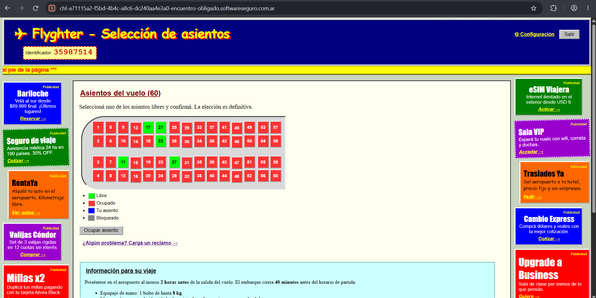
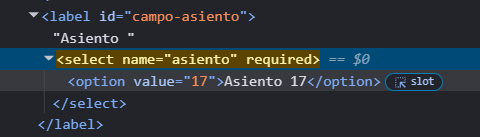
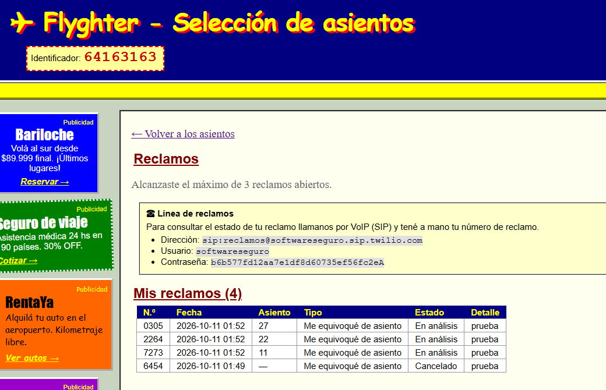
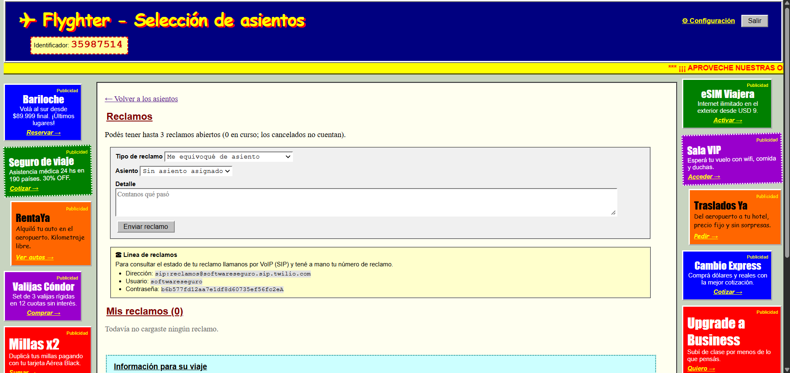
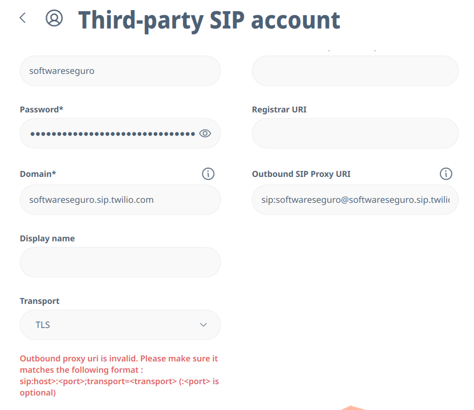
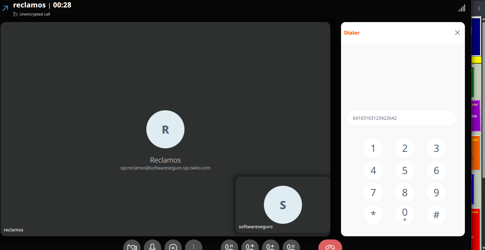
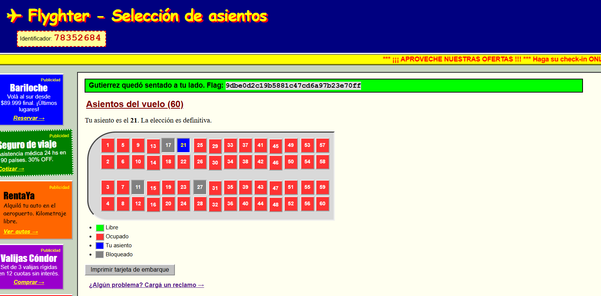

# Encuentro Obligado

**Plataforma:** HackLab (SoftwareSeguro)

**Edición:** HackLab 2026

**Categoría:** Condiciones de carrera

**Puntaje:** 50 (es el puntaje máximo de un desafío en la competencia)

**Herramientas:** Burp Suite (Repeater), PowerShell, Linphone (softphone SIP)

## Enunciado

> **Encuentro Obligado**
>
> En tu próximo vuelo necesitás sentarte al lado de un CEO de una empresa muy importante. Tenés el dato que todavía no hizo el checkin, por lo que no seleccionó el asiento. El CEO es una persona muy desconfiada y seguramente siempre elegirá un asiento distante al tuyo (parece que tiene información interna de quién está en cada asiento). Tenés que buscar la manera de que no le quede otra opción y elija un asiento al lado tuyo.
>
> Para hacer tu propio checkin contás con los siguientes datos:
> - **Código de checkin:** ACK-129
> - **Apellido:** BUSTAMENTE
>
> Podés hacer que el propio CEO ingrese a hacer el checkin. Para que el CEO ingrese al sitio, ya tenés preparado un ataque de Ingeniería Social: solo tenés que ingresar el dominio del desafío en un campo de texto (protocolo y dominio, sin path) y esto engañará al CEO y hará que ingrese a hacer el checkin y elegir su asiento. Solo podés hacerlo una vez por minuto. Esta funcionalidad no debe atacarse; es solo para obligar al CEO a ingresar al sitio.

**Objetivo:** lograr que el CEO, al hacer el check-in, no tenga más opción que un asiento contiguo al nuestro.

## Análisis

La aplicación (**Flyghter – Selección de asientos**) es un check-in online. Tras iniciar sesión con el código `ACK-129` y el apellido `BUSTAMENTE`, se muestra un mapa de **60 asientos** y la cabecera expone un **Identificador** numérico de 8 dígitos (p. ej. `35987514`).



El avión ya viene **casi lleno por diseño**: al entrar solo quedan unos pocos asientos libres y la numeración ubica los asientos contiguos en la misma columna (`17`/`18`, `21`/`22`, etc.). El CEO elige siempre "el más lejano disponible", así que para forzarlo hay que **dejar como único asiento libre el que está al lado nuestro** y bloquear el resto.

La leyenda del mapa distingue cuatro estados: **Libre** (verde), **Ocupado** (rojo), **Tu asiento** (azul) y **Bloqueado** (gris). El estado "Bloqueado" es la clave: un asiento bloqueado no es seleccionable.

### La sesión

La cookie `session` es un JWT de Flask (firmado, no cifrado). Su payload se lee en claro:

```json
{"apellido":"BUSTAMENTE","sid":"c3dcd8210d580f71f48d4b8450f7c39d"}
```

El servidor identifica al pasajero por esta cookie; las peticiones de asiento no llevan ningún otro identificador.

### Ocupar un asiento

Seleccionar un asiento es un POST simple. La identidad sale de la cookie, no del cuerpo:

```http
POST /asiento HTTP/2
Content-Type: application/x-www-form-urlencoded

numero=17
```

La elección es **definitiva** (un solo asiento por pasajero), así que no se puede "reservar todo el avión" por esta vía.

### El IDOR en los reclamos

La sección **Reclamos** permite abrir reclamos del tipo *"Me equivoqué de asiento"* (hasta 3 abiertos a la vez). El formulario envía:

```http
POST /reclamos HTTP/2
Content-Type: application/x-www-form-urlencoded

tipo=Me+equivoqu%C3%A9+de+asiento&asiento=17&descripcion=prueba
```

En la interfaz, el selector de asiento está limitado a **nuestro propio asiento**: su `<select>` solo contiene una opción.



```html
<label id="campo-asiento">
  "Asiento "
  <select name="asiento" required>
    <option value="17">Asiento 17</option>
  </select>
</label>
```

Pero esa restricción es **solo del lado del cliente**. Modificando el parámetro `asiento` en el cuerpo del POST, el backend acepta **cualquier número de asiento**, sea propio, ajeno, ocupado o libre. Se confirmó abriendo reclamos sobre asientos ajenos (p. ej. `27`, `22` y `11`); todos quedaron registrados a nombre nuestro. Esto es un **IDOR** clásico: el servidor no valida que el asiento reclamado pertenezca al emisor.



Por sí solos, los reclamos quedan en estado **Pendiente** y **no modifican el mapa**: hace falta *procesarlos*. El propio panel indica cómo:



> **Línea de reclamos** — Para consultar el estado de tu reclamo llamanos por VoIP (SIP) y tené a mano tu número de reclamo.
> - **Dirección:** `sip:reclamos@softwareseguro.sip.twilio.com`
> - **Usuario:** `softwareseguro`
> - **Contraseña:** `b6b577fd12aa7e1df8d60735ef56fc2eA`

El procesamiento de un reclamo se hace por un **canal telefónico (VoIP/SIP sobre Twilio)**, no por HTTP. En la sección **Configuración** se crea además una **clave telefónica de 4 dígitos** para identificarse al llamar (`POST /configuracion` con `accion=clave&clave=1234&repetir=1234`).

> Conceptos de telefonía usados en este desafío:
>
> - **SIP** (*Session Initiation Protocol*): protocolo estándar para llamadas de voz sobre IP. Un *softphone* (un teléfono por software) se **registra** contra un dominio SIP con usuario y contraseña, y luego puede **llamar** a una dirección `sip:destino@dominio`.
> - **IVR** (*Interactive Voice Response*): menú de voz automático del tipo "marque 1 para…" que atiende la llamada y pide datos.
> - **DTMF** (*Dual-Tone Multi-Frequency*): los tonos que emite cada tecla del teclado numérico; es la "marcación por tonos" con la que se responde al IVR.
 
Se buscó primero una contraparte HTTP del IVR (fuzzing de rutas como `/voice`, `/ivr`, `/webhook/twilio`, etc.) sin resultado: la aprobación del reclamo requiere la llamada SIP real.

## Explotación

### 1. Registrar el softphone y llamar al IVR

Se usó **Linphone** como softphone, registrando una cuenta SIP de terceros:

| Campo | Valor |
|---|---|
| Username | `softwareseguro` |
| Password | `b6b577fd12aa7e1df8d60735ef56fc2eA` |
| Domain | `softwareseguro.sip.twilio.com` |
| Transport | TLS |



> **Nota:** los campos **Registrar URI** y **Outbound SIP Proxy URI** deben quedar vacíos. El "Outbound SIP Proxy URI" espera el formato `sip:host:<port>;transport=<transport>` (solo host, sin la parte `usuario@`); poner ahí una identidad de usuario produce el error *"Outbound proxy uri is invalid"*. Con Username, Password, Domain y Transport alcanza para registrar.

Con la cuenta registrada se llama a `sip:reclamos@softwareseguro.sip.twilio.com` y se navega el menú con el teclado DTMF, que en Linphone se abre durante la llamada desde el menú **⋮ → Dialer**:



### 2. El menú del IVR

El IVR pide, en orden:

1. **Número identificador** → es el **Identificador de 8 dígitos** que muestra la cabecera de la web (no la clave telefónica ni el número de reclamo).
2. **Clave** → la clave telefónica de 4 dígitos creada en Configuración.
3. **Código de reclamo** → el N.º del reclamo a gestionar.

Una vez identificado, ofrece tres acciones sobre el reclamo:

- **Cancelar el reclamo** → lo cierra; deja de contar contra el límite de 3, lo que permite abrir reclamos nuevos.
- **Evaluar el reclamo** → pasa el reclamo a estado **En análisis**, y **el asiento reclamado queda Bloqueado (gris)** en el mapa.
- **Hablar con un humano.**

### 3. La cadena completa

La acción **"Evaluar el reclamo"** es la palanca: combinada con el IDOR, permite **bloquear asientos ajenos**. La estrategia:

1. Ocupar nuestro asiento, dejando **un contiguo libre** (su vecino de columna).
2. Abrir reclamos *"Me equivoqué de asiento"* (vía IDOR) sobre los **asientos libres que no son nuestro vecino**.
3. Por el IVR, **evaluar** cada reclamo → esos asientos quedan **Bloqueados**.
4. Como el límite es de 3 reclamos abiertos, **cancelar** los ya evaluados libera cupo para seguir bloqueando más asientos.
5. Repetir hasta que el **único asiento libre** sea el contiguo al nuestro.
6. Disparar la entrada del CEO (botón de ingeniería social): al no quedarle otra opción, elige el asiento de al lado.

> **Nota:** los reclamos "En análisis" terminan quedando como **cancelados** tras un tiempo, pero el bloqueo del asiento ya quedó aplicado, así que el efecto sobre el mapa persiste lo suficiente.

Con los asientos sobrantes bloqueados y un único contiguo libre, al forzar el ingreso del CEO este se sienta al lado:



```
Gutierrez quedó sentado a tu lado.
```

## Flag

```
9dbe0d2c19b5881c47cd6a97b23e70ff
```

## 🛡️ Remediación (Developer Perspective)

- **Validar la propiedad del recurso en el servidor.** El endpoint `POST /reclamos` debe verificar que el `asiento` reclamado pertenezca realmente al pasajero de la sesión, en lugar de confiar en que el `<select>` del formulario solo ofrezca el asiento propio. Limitar las opciones en el cliente no es un control de acceso.
- **No derivar autoridad de identificadores públicos.** El IVR autentica con un **Identificador de 8 dígitos que la web muestra en claro** en cada pantalla; un identificador visible no puede ser el factor que da acceso a la gestión de reclamos de una cuenta. La identificación telefónica debería exigir un secreto que no esté expuesto en la interfaz.
- **No publicar credenciales de servicios internos.** Las credenciales SIP (usuario y contraseña del dominio Twilio) estaban embebidas en una página accesible al usuario; cualquiera podía registrar un softphone y operar el canal de reclamos. Esas credenciales deben vivir solo en el backend.
- **Controlar los efectos de los reclamos.** "Evaluar" un reclamo no debería poder **bloquear un asiento arbitrario** de forma inmediata y sin revisión humana: la transición de estado de un asiento debe validar quién la solicita y sobre qué asiento, y registrarse para auditoría.
