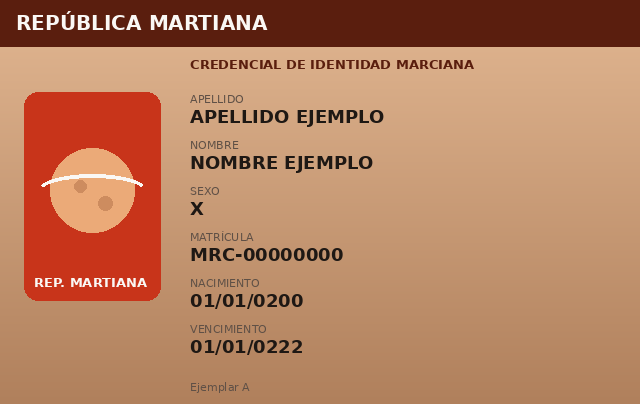
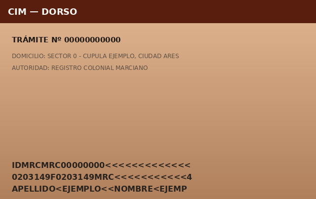
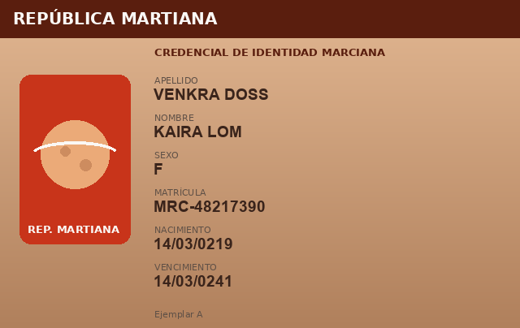
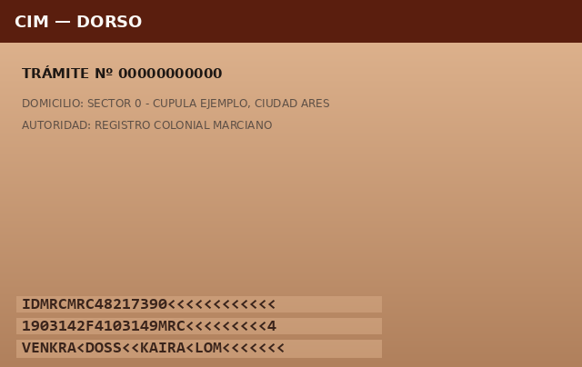
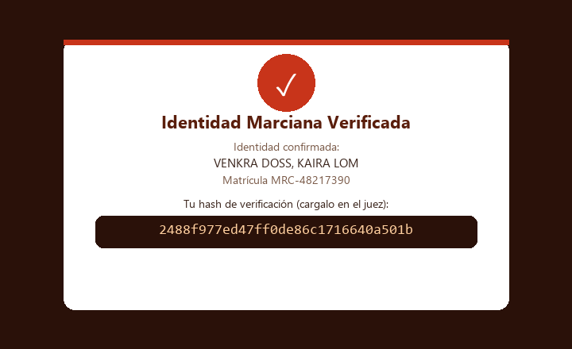

# Capturando al Ladrón

**Plataforma:** HackLab (SoftwareSeguro)

**Edición:** HackLab 2026

**Categoría:** Reversing Apk

**Puntaje:** 40

**Herramientas:** Python (androguard, Pillow, urllib), curl

## Enunciado

> Corre el año 264 en la República Martiana. Allí cada ciudadano se identifica
> con su Credencial de Identidad Marciana (CIM). **VerificAR Marte** es la app
> oficial que verifica esa identidad: le sacás una foto al frente y otra al
> dorso de tu credencial y, si todo está en orden, el servicio emite a tu nombre
> un certificado de identidad marciana verificada.
>
> Antes de enviar nada, la app lee los datos por OCR, valida el formato de la
> credencial, reconoce el logo oficial y te muestra los datos sin dejarte
> editarlos.
>
> **Objetivo:** hay una ladrona suelta y tu misión es hacerte pasar por ella
> para obtener sus datos. Lográ que el servicio emita el certificado a nombre de
> **VENKRA DOSS, KAIRA LOM** (matrícula **MRC-48217390**), que tiene 45 años.

Se entrega un único archivo, [`verificar.apk`](./assets/verificar.apk).

Así se ve una CIM (modelo de ejemplo, con datos de relleno):

| Frente | Dorso |
|---|---|
|  |  |

## Análisis

### El APK y su lógica

Un APK es un ZIP, así que se descomprime directamente. A diferencia de otros
desafíos de esta categoría, acá **no** es una app híbrida (Ionic/Capacitor): es
una app **nativa Kotlin/Android**. La lógica vive en los `classes*.dex`, que se
decompilan con [androguard](https://github.com/androguard/androguard) (Python
puro, sin necesidad de Java ni emulador):

> **androguard.** Librería/herramienta de Python para analizar apps
> Android. El código de un APK viaja compilado en archivos `classes*.dex`
> (bytecode **DEX**, el que ejecuta la VM de Android), que no es legible
> directamente. androguard parsea esos DEX y el `AndroidManifest.xml` binario, y
> permite listar clases, decompilar métodos a un pseudo-Java y recorrer las
> llamadas. Es la alternativa cuando no hay Java instalado para las herramientas
> clásicas (jadx, apktool, dex2jar); su ventaja extra es que todo el análisis es
> *scripteable* desde Python.

```python
from androguard.misc import AnalyzeAPK
a, d, dx = AnalyzeAPK("verificar.apk")
# clases propias: com.vulnlabs.verificar.*
for c in dx.classes:
    if c.name.startswith("Lcom/vulnlabs/verificar"):
        print(c.name)
```

El paquete es `com.vulnlabs.verificar` y las clases propias son pocas:
`MainActivity` → `CapturaActivity` (cámara) → `ConfirmarActivity` (muestra los
datos read-only) → `ResultadoActivity`, más los helpers `Ocr`, `Imagen`,
`Credencial`, `Config` y `Api`. Las carpetas `assets/mlkit-google-ocr-models/`
son solo los modelos de **ML Kit** (el OCR de Google que usa la app en el
dispositivo).

### Toda la "seguridad" corre en el cliente

Las dos clases clave son `Config` y `Api`:

```java
// Config
public static final String SERVIDOR_URL = "https://auth.shared.softwareseguro.com.ar";

// Api.verificar(...) arma un multipart/form-data y lo postea a /api/verificar
new okhttp3.MultipartBody.Builder().setType(MultipartBody.FORM)
    .addFormDataPart("apellido", p27)
    .addFormDataPart("nombre", p28)
    .addFormDataPart("matricula", p29)
    .addFormDataPart("sexo", p30)
    .addFormDataPart("fecha_nacimiento", p31)
    .addFormDataPart("foto_frente", "frente.jpg", RequestBody.create(new File(p32), JPEG))
    .addFormDataPart("foto_dorso",  "dorso.jpg",  RequestBody.create(new File(p33), JPEG))
    .build();
// ... .url(baseUrl + "/api/verificar").post(body)
```

El resto de la app es **solo interfaz**:

- `Ocr.leerCredencial()` usa ML Kit para leer el texto y `Ocr.parsear()` arma un
  `DatosCim` buscando `APELLIDO`, `NOMBRE`, `SEXO`, la matrícula
  (`MRC[-\s]?\d{8}`) y una fecha.
- `Credencial.formatoValido()` valida con regex (`^MRC-\d{8}$`,
  `^\d{2}/\d{2}/\d{4}$`, sexo en `{F,M,X}`).
- `Credencial.logoReconocido()` abre la foto y comprueba, por el promedio de
  color de una región, que el logo rojo esté presente.
- `ConfirmarActivity` muestra los campos en `TextView` que no se pueden editar.

**Nada de eso protege el recurso.** Toda esa validación ocurre en el teléfono y
su único efecto es rellenar la pantalla de confirmación. Lo que llega al backend
es un `multipart` con **campos de texto que el atacante controla por completo** y
dos imágenes. No hace falta instalar la app, tener root ni usar un emulador:
basta con reproducir ese POST.

Esta es la idea central del desafío: cuando los controles de seguridad (formato,
OCR, "campos no editables", reconocimiento de logo) se ejecutan en código que el
usuario controla, son cosméticos: sirven para la experiencia de uso, no como
barrera. La única validación que cuenta es la que hace el servidor.

### Qué valida realmente el servidor

El servidor está vivo. Su portada (`GET /`) documenta la API
(`POST /api/verificar` multipart, `GET /salud`), sirve el modelo de credencial
en `/static/modelo_dni_frente.png` y `/static/modelo_dni_dorso.png`, y —clave—
revela **a quién pertenece la cuenta a verificar**:

> **VENKRA DOSS, KAIRA LOM** — Matrícula MRC-48217390 — Sexo F —
> Nacimiento 14/03/0219 — Vence 14/03/0241

(264 − 219 = 45 años, como pedía el enunciado.)

La respuesta de `/api/verificar` trae un objeto `controles` que es un mapa
exacto de lo que el backend chequea. Posteando los datos del objetivo con las
imágenes modelo *tal cual*:

```json
{
  "controles": {
    "datos": true,
    "foto_frente": true,
    "dorso": true,
    "similitud_frente": { "distancia": 0, "umbral": 22 },
    "ocr_frente": false,
    "ocr_dorso": false,
    "ocr_no_coincide": {
      "frente": ["apellido","nombre","matricula","sexo","fecha_nacimiento"],
      "dorso":  ["apellido","nombre","matricula"]
    }
  },
  "verificado": false
}
```

De acá se deduce **todo el criterio del servidor**:

- `datos` → los campos de texto enviados deben ser los del objetivo. ✅ (se los
  pasamos nosotros)
- `similitud_frente` → compara el frente contra el modelo oficial con un **hash
  perceptual** y acepta si la distancia es menor al **umbral 22**. El modelo da
  distancia 0; tenemos mucho margen para editar texto sin romperlo.
- `foto_frente` → chequeo del logo sobre el frente.
- `ocr_frente` → el texto que el servidor lee del **frente** debe coincidir con
  los 5 campos.
- `ocr_dorso` → el texto que el servidor lee del **dorso** (la MRZ) debe
  coincidir con apellido, nombre y matrícula.

> **hash perceptual.** A diferencia de un hash criptográfico (donde
> cambiar un bit cambia todo), un *perceptual hash* (pHash/aHash) produce firmas
> parecidas para imágenes parecidas. La "distancia" (Hamming) entre dos firmas
> mide cuán distintas se ven. Un umbral de 22 es generoso: podemos reescribir el
> texto de la credencial siempre que el **aspecto general** (colores, logo,
> maquetación) se mantenga.
>
> **MRZ (Machine Readable Zone).** Las dos/tres líneas en monoespaciado
> del dorso, al estilo ICAO 9303. El modelo trae una MRZ TD1 con la matrícula
> dentro del número de documento (`IDMRC`**`MRC00000000`**`<<<`) y el nombre en
> la última línea (`APELLIDO<EJEMPLO<<NOMBRE<EJEMP`). El servidor lee esos campos
> por OCR.

El plan queda claro: partir de las imágenes modelo (que ya pasan logo y
similitud) y **reescribir encima el texto** con los datos de la ladrona, en el
frente y en la MRZ del dorso, sin alterar el diseño.

### La cadena, de punta a punta

El ataque combina dos fuentes de información: **el código** del APK dice *cómo y
a dónde* enviar, y **el propio servidor** (vía `controles`) dice *qué tiene que
cumplir cada imagen*. Ninguna de las dos alcanza por sí sola.

```
Reversing del APK  →  URL + formato del multipart + "el cliente no valida nada"
        │
        ▼
POST directo con los datos de la ladrona
        │
        ▼
El servidor responde "controles"  →  dice QUÉ chequea sobre las imágenes
        │
        ▼
Forjar frente y dorso (parecidos al modelo + OCR correcto) e iterar contra "controles"
        │
        ▼
verificado: true  →  certificado  →  flag
```

## Explotación

### 1. Obtener los insumos

```bash
curl -s -o modelo-frente.png https://auth.shared.softwareseguro.com.ar/static/modelo_dni_frente.png
curl -s -o modelo-dorso.png  https://auth.shared.softwareseguro.com.ar/static/modelo_dni_dorso.png
```

### 2. Forjar el frente

Se tapan los seis valores copiando una tira limpia del degradado del propio
panel y se reescribe el texto del objetivo con una fuente similar
([`forjar_frente.py`](./forjar_frente.py)):

```bash
python forjar_frente.py modelo-frente.png forjado-frente.png
```



### 3. Forjar el dorso (MRZ)

Se reescriben las tres líneas de la MRZ con la matrícula y el nombre del
objetivo, manteniendo el formato ([`forjar_dorso.py`](./forjar_dorso.py)):

```
IDMRCMRC48217390<<<<<<<<<<<<
1903142F4103149MRC<<<<<<<<<4
VENKRA<DOSS<<KAIRA<LOM<<<<<<<
```

```bash
python forjar_dorso.py modelo-dorso.png forjado-dorso.png
```



### 4. Enviar el multipart

[`verificar.py`](./verificar.py) reproduce exactamente el POST de `Api.verificar`
(mismos campos, `User-Agent: okhttp/...`) con las imágenes forjadas:

```bash
python verificar.py forjado-frente.png forjado-dorso.png
```

```json
{
  "certificado_url": "/certificado?token=7552a909e2f20be956b5f42c53674f24437a2865277f8ccf100a8000b6dd0b06",
  "controles": {
    "datos": true,
    "dorso": true,
    "foto_frente": true,
    "ocr_dorso": true,
    "ocr_frente": true,
    "similitud_frente": { "distancia": 1, "umbral": 22 }
  },
  "mensaje": "Identidad marciana verificada. Cuenta habilitada.",
  "token": "7552a909e2f20be956b5f42c53674f24437a2865277f8ccf100a8000b6dd0b06",
  "verificado": true
}
```

Todos los controles pasan (`similitud_frente` quedó en distancia 1, muy por
debajo de 22) y `verificado` es `true`.

### 5. Recoger el certificado

```bash
curl -s "https://auth.shared.softwareseguro.com.ar/certificado?token=7552a909e2f20be956b5f42c53674f24437a2865277f8ccf100a8000b6dd0b06"
```

El certificado se emite a nombre de **VENKRA DOSS, KAIRA LOM** y muestra el hash
de verificación (la flag):



## Flag

```
2488f977ed47ff0de86c1716640a501b
```

## 🛡️ Remediación (Developer Perspective)

- **No delegar la verificación de identidad al cliente.** El OCR, el chequeo de
  formato, el reconocimiento de logo y los "campos no editables" de la app son
  comodidad de UX, no control de seguridad: el servidor debe asumir que el
  cliente miente y revalidar todo por su cuenta.
- **El servidor debe atar los datos reclamados a la evidencia.** No alcanza con
  que *alguna* foto se parezca a una credencial: hay que verificar que los datos
  afirmados provienen realmente del documento fotografiado y que éste es
  auténtico. Un hash perceptual contra una plantilla pública es trivial de
  pasar, porque el atacante también tiene la plantilla.
- **La imagen "modelo" no debería ser utilizable como insumo válido.** Servir el
  modelo oficial desde `/static/` y aceptarlo (distancia 0) le regala al
  atacante una base que ya pasa la mitad de los controles.
- **La identidad a verificar no debería ser un dato público.** Exponer el titular
  esperado (nombre, matrícula, fechas) en la portada convierte el "verificar que
  sos vos" en "copiar estos campos".
