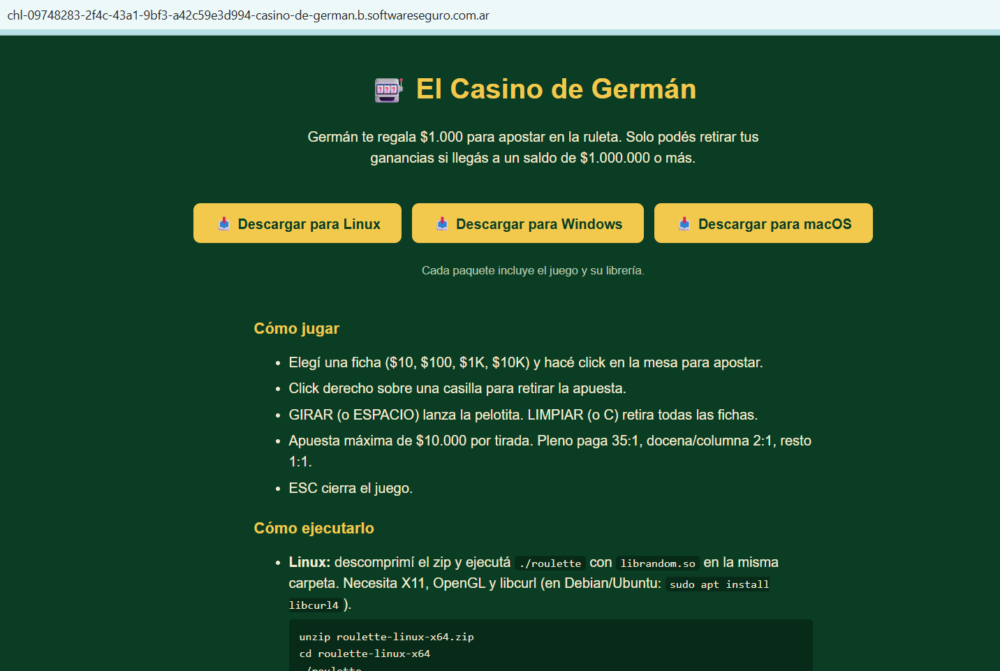
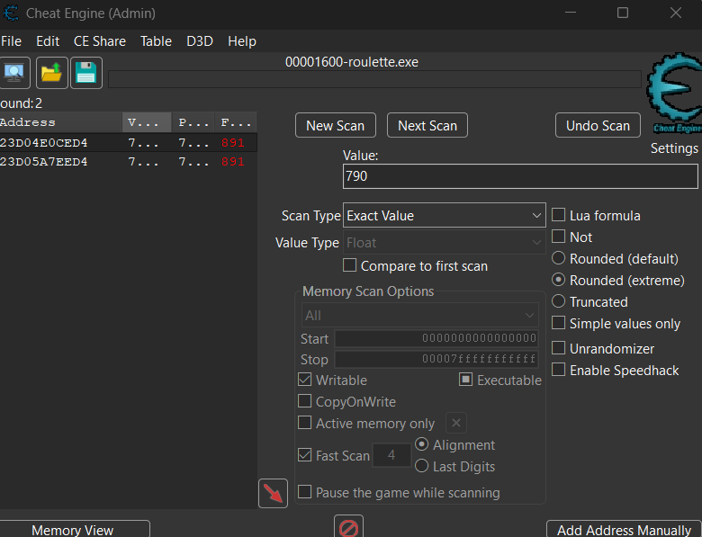
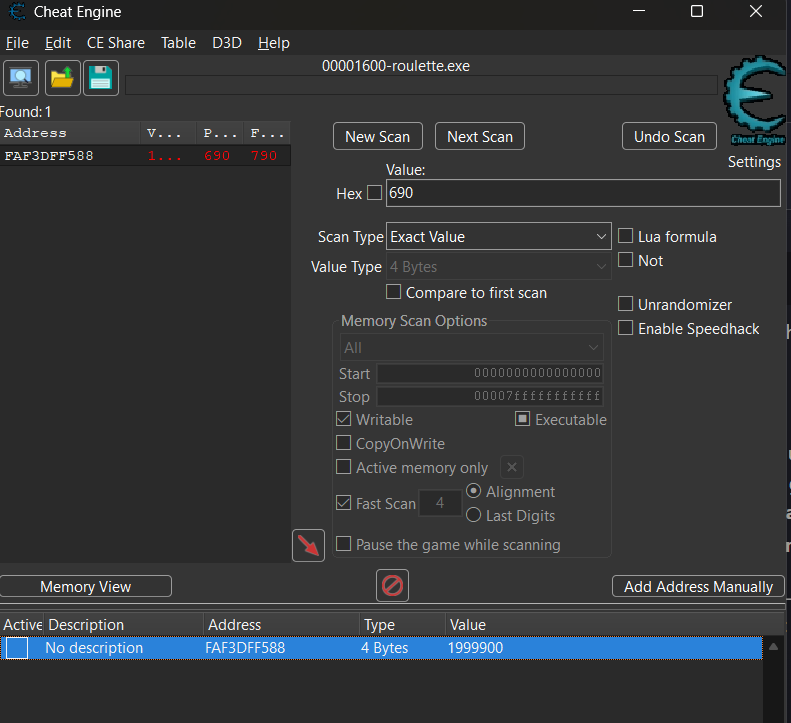
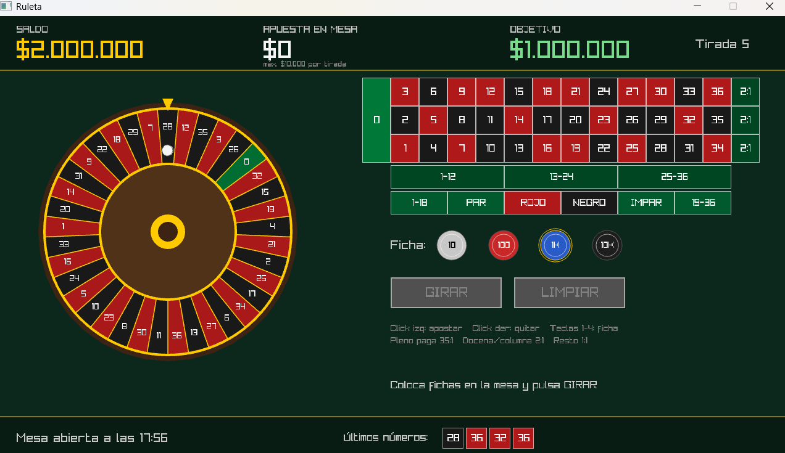
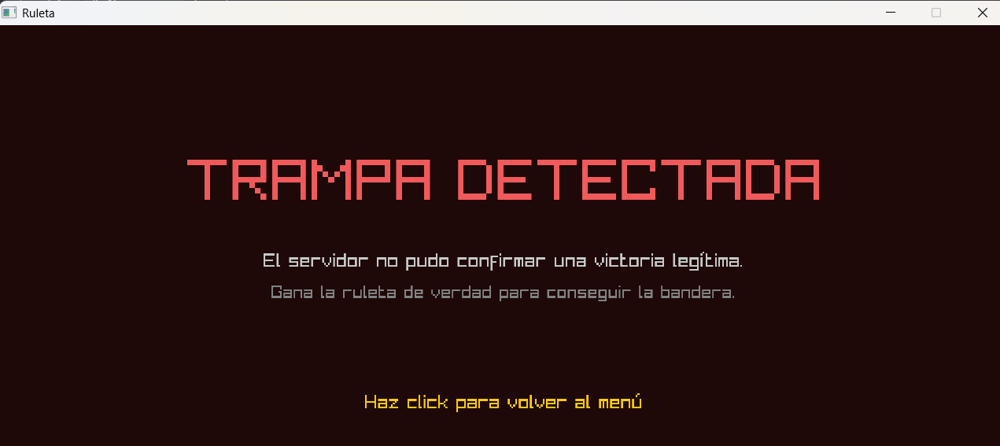
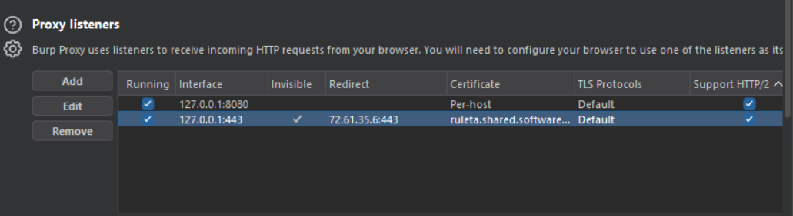
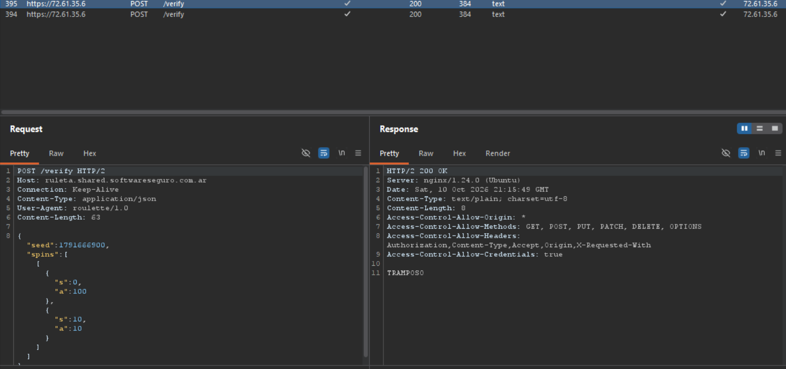
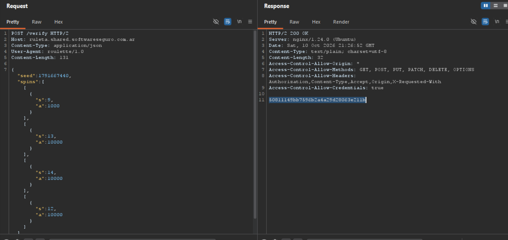

# El Casino de Germán

**Plataforma:** HackLab (SoftwareSeguro)

**Edición:** HackLab 2026

**Categoría:** Reversing Desktop Apps - Lógica de negocio

**Herramientas:** Python (pefile, Capstone), Cheat Engine, Burp Suite (Proxy invisible + Repeater)

## Enunciado



Germán lanzó un casino virtual y da una oferta: **$1.000 de regalo** para apostar en
la ruleta. El detalle: solo podés retirar tus ganancias si llegás a un saldo de
**$1.000.000 o más**.

El juego se descarga como cliente de escritorio (`roulette.exe` + `random.dll` en
Windows; `librandom.so` en Linux). Apuesta máxima de **$10.000 por tirada**. Pleno
paga **35:1**, docena/columna 2:1, resto 1:1.

**Objetivo:** llegar a un saldo de $1.000.000 para que el servidor entregue la flag.

## Análisis

Se entregan dos binarios PE32+ x86-64 (en [`assets/`](./assets/)): `roulette.exe` (el
juego, hecho con **raylib**) y `random.dll` (la librería de aleatoriedad). Ambos
compilados con **MinGW**.

> **raylib:** librería en C para hacer videojuegos. Se encarga de abrir la
> ventana, dibujar por GPU (usa OpenGL por debajo, de ahí el requisito de OpenGL) y
> leer teclado/mouse. Todo lo visual del juego (la rueda, las fichas, los textos) está
> dibujado con ella. Se la reconoce por sus strings de OpenGL y shaders en el binario
> (`glCompileShader`, `SHADER: ...`). Al ser open source, se puede comparar el binario
> con su código fuente público para identificar funciones.

> **MinGW:** versión de GCC (el compilador de C/C++ de Linux) para Windows.
> Es con lo que se compiló el juego a `.exe`/`.dll`. Deja huellas útiles para el
> reversing: strings como `__mingwthr_...` o rutas `.../libgcc/...` y `random.c`, y
> **modismos de código** predecibles (p. ej. el bloque `imul 0x8888888888888889` +
> shifts no es más que la forma optimizada en que GCC implementa un `% 60`).

### La librería `random.dll`

La DLL exporta solo **dos funciones** (`random_init`, `random_next`) y su único import
relevante es `_time64`. Eso ya sugiere un PRNG sembrado con el tiempo. Desensamblando
con Capstone:

> **PRNG (Pseudo-Random Number Generator):** algoritmo que produce números que
> *parecen* aleatorios pero son **deterministas**: se calculan con una fórmula a partir
> de un valor inicial llamado **semilla** (*seed*). Con la misma semilla sale siempre la
> misma secuencia. No hay azar real, así que **quien conoce la fórmula y la semilla
> puede recalcular todos los números de antemano** — justamente la raíz de este
> desafío. (Para usos sensibles —apuestas, tokens, claves— se usa un **CSPRNG**, un PRNG
> *criptográficamente seguro*, diseñado para que las salidas no se puedan predecir.)

**`random_init`** siembra el estado con la hora:

```asm
call  _time64            ; t = time(NULL)
...                      ; (optimización del compilador para t % 60)
imul  edx, eax, 0x3c     ; *60
...
mov   [rip+state], eax   ; state = t % 60
```

> **Nota — el operador `%` es el módulo (resto), no un porcentaje.** `a % b` es el
> **resto** de dividir `a` entre `b`. Acá `t % 60` toma el timestamp `t` (en segundos)
> y se queda con el **resto de dividirlo por 60**, es decir un valor entre `0` y `59`
> (en la práctica, "el segundo dentro del minuto"). Reduce el seed a solo 60 valores
> posibles — suficiente para variar la animación, pero clave más adelante.

**`random_next`** es un **LCG** (Linear Congruential Generator) clásico y devuelve un
número de ruleta (0–36):

```asm
imul  eax, eax, 0x41c64e6d   ; state = state * 1103515245
add   eax, 0x3039            ;        + 12345
mov   [rip+state], eax
shr   eax, 0x10              ; x = state >> 16
...                          ; (optimización del compilador para x % 37)
```

Reconstruido, el algoritmo es:

```python
state = (state * 0x41c64e6d + 0x3039) & 0xFFFFFFFF
numero = (state >> 16) % 37
```

> **LCG:** un generador de números pseudoaleatorios que produce cada valor
> a partir del anterior con `state = state * a + c (mod m)`. No es criptográficamente
> seguro: conociendo `a`, `c`, `m` y un estado, **toda la secuencia es predecible**.
> Acá `a = 0x41c64e6d`, `c = 0x3039`, `m = 2³²` son constantes fijas en el binario.

### Protocolo con el servidor

El `roulette.exe` importa **WINHTTP.dll** y las cadenas revelan el endpoint y el
formato del mensaje:

```
https://ruleta.shared.softwareseguro.com.ar/verify
{"seed":%ld,"spins":[
%s{"s":%d,"a":%d}
TRAMPA DETECTADA
```

Es decir, el cliente postea a `/verify` un JSON con esta forma:

```json
{"seed": <long>, "spins": [ [ {"s": <int>, "a": <int>} ], ... ]}
```

- `spins` es una **lista de giros**; cada giro es una **lista de apuestas**.
- Cada apuesta es `{"s": <casilla>, "a": <monto>}` (en un pleno, `s` es el número 0–36).

El flujo en el binario: al presionar GIRAR se llama `random_init` y `random_next`
para la animación, y **al alcanzar el saldo objetivo** se postea la partida completa
a `/verify`. El salto que dispara el POST es una sola comparación:

```asm
mov   eax, [rsp+0x88]    ; eax = saldo
cmp   eax, 0xf423f       ; 999999
jg    <post_verify>      ; si saldo >= 1.000.000 -> POST /verify
```

**La clave:** el servidor **re-simula** la partida con el `seed` recibido (usando el
mismo LCG) y valida que las apuestas y el saldo final sean consistentes. No confía en
el saldo que reporta el cliente — por eso inflar el saldo en memoria no alcanza.

## Enfoques descartados

- **Editar el saldo en memoria (Cheat Engine).** La idea es encontrar la dirección de
  memoria donde el juego guarda el saldo y sobrescribirla con un valor arbitrario. El
  proceso con Cheat Engine:

  1. Se adjunta Cheat Engine al proceso `roulette.exe` y se hace un **primer escaneo**
     (*First Scan*) buscando el saldo actual como *Exact Value*. Un escaneo por el
     valor entero `1000` no devuelve nada: el saldo **no** se guarda como entero sino
     como **`float`** (número de punto flotante). Cambiando el *Value Type* a `Float` y
     escaneando `1000`, aparecen candidatos.
  2. Como un *First Scan* deja cientos de direcciones con ese valor, hay que
     **filtrarlas**: se cambia el saldo en el juego (apostar y girar lo baja, p. ej. a
     `790`), y se hace un *Next Scan* por el nuevo valor. Repitiendo (cambiar saldo →
     *Next Scan* con el valor nuevo), las direcciones que no sigan al saldo se
     descartan hasta quedar con **muy pocas** — en este caso dos (las columnas
     *Value / Previous / First* muestran cómo el valor fue bajando a `790`):

     

  3. Se bajan esas direcciones a la tabla inferior y se **sobrescribe su valor** (doble
     click en la columna *Value*). Acá se dejó una sola dirección (`FAF3DFF588`) con el
     valor editado a `1999900`; se puede *congelar* con el checkbox *Active* para que el
     juego no lo recalcule:

     

  4. En pantalla el SALDO pasa a mostrar el valor forzado (**$2.000.000**):

     

  Al superar el millón, el juego **sí** dispara el POST a `/verify`, pero como el
  servidor re-simula con el seed y los giros reales (que no suman un millón),
  responde **`TRAMPA DETECTADA` — "El servidor no pudo confirmar una victoria
  legítima"**. El saldo local es irrelevante para la validación.

  

- **Asumir que el servidor arranca el LCG con `seed % 60`, igual que la DLL.** Error.
  `% 60` es el **resto** de dividir por 60 (no un porcentaje): reduce el seed a un valor
  entre `0` y `59`. La DLL hace eso **solo para la animación local** de la ruleta; no
  afecta la validación.

  El problema de copiar ese `% 60`: muchos seeds distintos dan el **mismo resto** y, por
  lo tanto, la **misma secuencia** de números. Por ejemplo `1791667440`, `1791666900` y
  `1791666780` dan los tres resto `0`, así que con esta hipótesis predicen exactamente
  los mismos giros — lo cual implicaría que solo existen 60 partidas posibles y no
  coincidía con la realidad.

  El servidor en cambio usa el **seed completo** (sin reducir) como estado inicial del
  LCG. Se confirmó con un giro legítimo capturado: para `seed = 1791667440` salió el
  **9** en la ruleta, y ese 9 coincide **solo** con la fórmula del seed completo
  (`(seed·a + c) >> 16` y luego **resto** `37`), no con la del `% 60` (que daba `0`).
  Un único par real (seed → número que salió) bastó para descartar una fórmula y
  confirmar la otra.

## Explotación

La vulnerabilidad es de **lógica de negocio**: el servidor confía en un `seed` elegido
por el cliente y en un PRNG público (está en la DLL). Por lo tanto se puede **predecir
cada número** y fabricar un historial de apuestas a pleno siempre ganadoras,
internamente consistente con la re-simulación del servidor.

### Interceptar el tráfico (Burp Suite)

El `.exe` usa WinHTTP, que **ignora el proxy del sistema** (`netsh winhttp set proxy`
no basta: el tráfico se escapa de Burp). La forma que funcionó fue **redirigir el
dominio por DNS** y usar Burp en **modo invisible**:

> **WinHTTP:** una de las APIs HTTP de Windows (la otra es WinINET). La
> diferencia práctica acá: WinINET respeta la configuración de proxy del navegador,
> pero **WinHTTP no lee ese proxy automáticamente**, por eso las apps que la usan
> (como este juego) esquivan a Burp aunque esté configurado como proxy del sistema.

> **Proxy MITM e "invisible":** un proxy *Man-In-The-Middle* se ubica entre
> cliente y servidor y, presentando su propia CA (instalada como confiable), descifra
> el HTTPS para ver y modificar el tráfico. Un proxy normal espera que el cliente le
> hable a él sabiendo que es un proxy. El modo **invisible** acepta conexiones de un
> cliente que *cree estar hablando con el servidor real*: por eso se redirige el
> dominio a `127.0.0.1` con el `hosts` y Burp reenvía al servidor verdadero.

1. Agregar al `hosts` (como admin): `127.0.0.1 ruleta.shared.softwareseguro.com.ar`
   (y la variante `::1` por IPv6), luego `ipconfig /flushdns`.
2. En Burp, un **listener invisible** en `127.0.0.1:443` con *Redirect to host*
   `72.61.35.6:443` (la IP real) y *Force use of TLS*.
3. Instalar la CA de Burp en el almacén **Trusted Root** de Windows (`certutil
   -addstore -f Root cacert.der`).
4. **Reiniciar el juego** para que tome el nuevo DNS.



Con eso, el POST a `/verify` cae en Burp. Un giro legítimo capturado:

```json
{"seed":1791667440,"spins":[[{"s":5,"a":100}]]}
```



### Fabricar la partida ganadora

Conociendo el LCG, se predice el número de cada giro y se apuesta el máximo a pleno a
ese número (35:1). Script completo en [`./solve.py`](./solve.py). El núcleo:

```python
MASK = 0xFFFFFFFF
def siguiente_numero(state):
    state = (state * 0x41c64e6d + 0x3039) & MASK   # LCG con seed COMPLETO (sin %60)
    return state, (state >> 16) % 37

def generar_partida(seed):
    state, saldo, spins = seed & MASK, 1000, []
    while saldo < 1_000_000:
        state, numero = siguiente_numero(state)
        apuesta = min(saldo, 10_000)                # nunca apostar más que el saldo
        spins.append([{"s": numero, "a": apuesta}]) # apuesta a pleno al número ganador
        saldo = saldo - apuesta + apuesta * 36      # pleno paga 35:1 -> 36x
    return {"seed": seed, "spins": spins}
```

Con `seed = 1791667440`, la secuencia predicha es `9, 13, 14, 12`. Partiendo de $1.000
(primera apuesta limitada al saldo disponible), en **4 giros** el saldo llega a
$1.086.000:

```json
{"seed": 1791667440, "spins": [[{"s": 9, "a": 1000}], [{"s": 13, "a": 10000}], [{"s": 14, "a": 10000}], [{"s": 12, "a": 10000}]]}
```

Se envía por **Burp Repeater** (o con `solve.py --send`). El servidor re-simula, todo
cuadra, y responde `200 OK` con la flag:



## Flag

```
50811149bb7596b2a4a29d28063e211b
```

## 🛡️ Remediación (Developer Perspective)

- **La semilla no puede venir del cliente.** El resultado de cada tirada tiene que
  generarse **en el servidor**, con un PRNG **criptográficamente seguro** (CSPRNG) y
  una semilla secreta que el cliente nunca ve ni elige. Entregarle al cliente el seed
  y el algoritmo (en una DLL) convierte el azar en algo totalmente predecible.
- **El servidor manda la autoridad del juego, no la valida a posteriori.** En vez de
  dejar que el cliente juegue libre y después "re-simular" un historial que él mismo
  arma, el servidor debe ser la fuente de verdad de cada giro: el cliente apuesta, el
  servidor sortea y responde el resultado. Así no hay un `seed` ni un historial
  falsificables.
- **No embeber la lógica de aleatoriedad en el binario.** `random.dll` expone el LCG
  completo (constantes incluidas). Cualquier lógica que decida dinero debe vivir del
  lado del servidor, fuera del alcance del jugador.
- **Un LCG nunca es apto para apuestas.** Aun con semilla secreta, un LCG es
  predecible observando pocas salidas. Para cualquier sorteo con valor económico, usar
  un CSPRNG.
